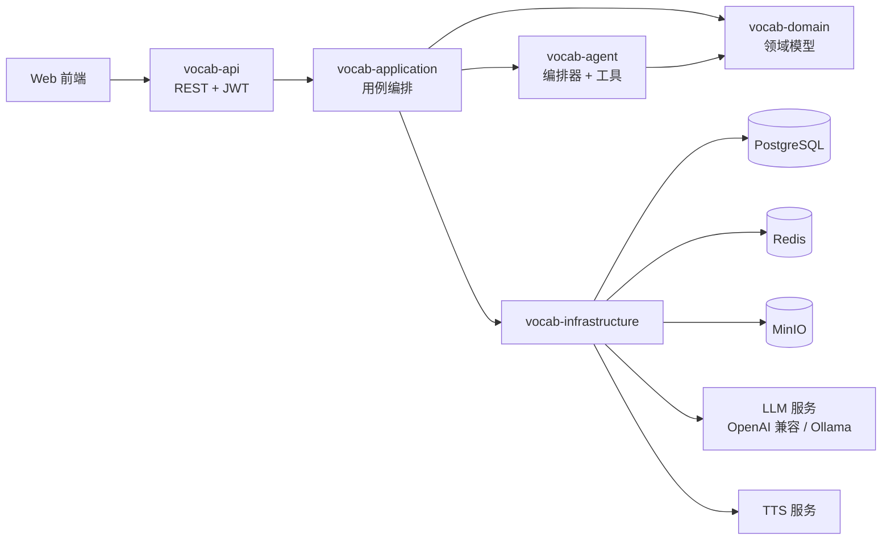
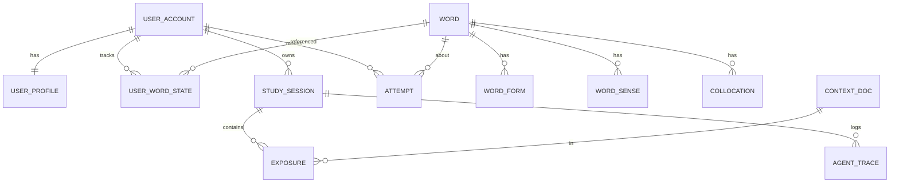
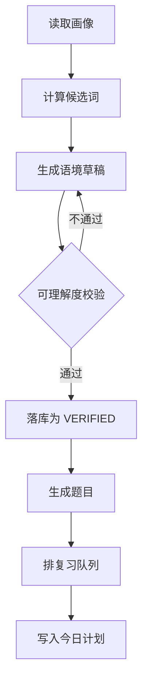
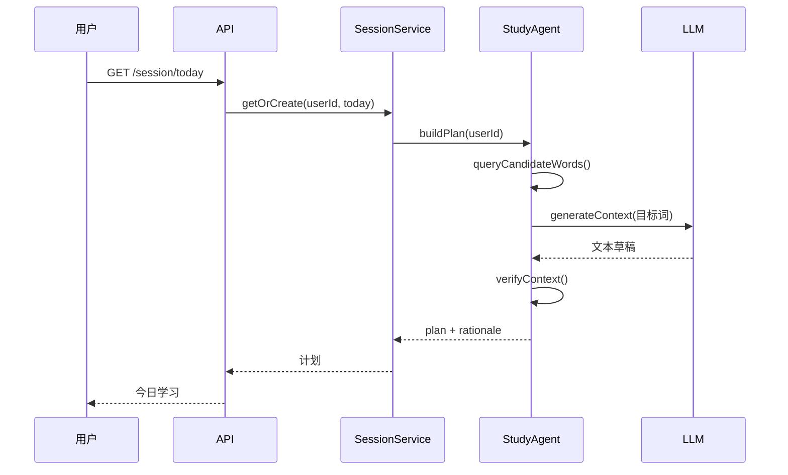
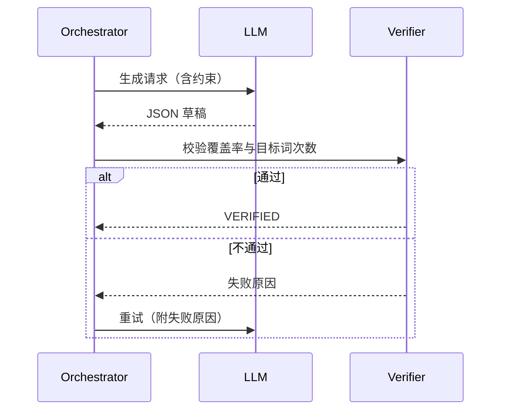

# 基于智能体的个性化语境式英语词汇学习平台 · 设计方案

| 项目 | 内容 |
|---|---|
| 文档版本 | v1.0 |
| 日期 | 2026-11-09 |
| 后端技术栈 | Java 21 LTS + Spring Boot 3.3+ |
| 数据存储 | PostgreSQL 16 + Redis 7 + MinIO |
| 前端形态 | 响应式 Web（后续可扩展小程序） |
| 设计依据 | NGSL 1.2 词表、《告诉你外语学习的真实方法与误区分析》、《找对英语学习方法的第一本书》 |

---

## 1. 设计依据

### 1.1 资料盘点

| 资料 | 可用内容 | 在系统中的作用 |
|---|---|---|
| NGSL 1.2 词表 | 2809 个 NGSL 词元、47 个补充词（SUP）、955 个学术词（NAWL） | 选词与分级的底座 |
| `NGSL+with+SFI+(31K).xlsx` | 31,240 行，含 SFI 排名、SFI 值、每百万调整频次 U、分布均匀度 D、单词覆盖率、累计覆盖率 | 计算"先学谁" |
| `NGSL_1.2_with_English_definitions.xlsx` | 2809 条英文释义 | 释义兜底与英英解释 |
| `NGSL_1.2_lemmatized_for_teaching.csv` | 词元与词形对应 | 词族识别、文本词形还原 |
| 《告诉你外语学习的真实方法与误区分析》 | 常见误区清单、可理解输入、无效输入、4 秒声音缓存、发音取决于听辨 | 决定"怎么学" |
| 《找对英语学习方法的第一本书》 | 70%–80% 可懂度、20%–30% 生词、人造语言环境的可控重复、输入优先、成人习得周期 | 决定"语境难度与复现机制" |
| 知乎链接两条 | 因反爬未取到正文 | 本版不采用 |

### 1.2 NGSL 实测结论

按 `NGSL+with+SFI+(31K).xlsx` 的 `Coverage` 列累加，得到：

| 累计词数 | 文本覆盖率 |
|---|---|
| 500 | 74.3% |
| 1000 | 81.8% |
| 1500 | 85.8% |
| 2000 | 88.3% |
| 2500 | 90.0% |
| 2809 | 90.8% |

三条可直接用于产品的结论：

1. **覆盖率增长是强递减的**。前 1000 词买到 81.8%，后 1809 词只多买 9 个百分点。选词必须按"覆盖收益"排序，而不是按字母序或教材单元。
2. **频次高不等于该早学**。`unclear` 每百万出现 106 次，但 `D`（分布均匀度）仅 0.05，说明它高度集中在少数文本类型。D 值低于阈值的词需要降权。
3. **词表天然分层**。NGSL（通用）→ SUP（补充）→ NAWL（学术），可以直接映射为三条学习路径，不需要重新造分级体系。

### 1.3 方法论到系统机制的映射

| 资料观点 | 系统机制 |
|---|---|
| 听不懂的输入等于噪音 | 语境生成后必须做"已知词覆盖率"校验，不达标重写 |
| 材料听懂 70%–80% 最合适 | 听力材料按 75% 可懂度生成；阅读材料按 95% 已知词生成 |
| 真实环境里同一表达复现率极低 | 由系统强制同一目标词在多个语境、多个时间点复现 |
| 声音印象只保留约 4 秒 | 目标词在单篇内至少出现 2 次，且不连续；听力材料做 3 次间隔复现 |
| 输入是必要且充分条件，输出不是 | 主线是读/听后的再认与回忆，输出题只用于暴露漏洞 |
| 成人达到流利约为年龄 ÷ 6 年 | 学习目标按"可读文本比例"设定，不承诺短期流利 |
| 发音问题源于听辨 | 拼写与辨音题使用最小对立对，并提供多口音音频 |

### 1.4 资料缺口

以下内容资料区没有提供，必须在方案中补齐：

- 中文释义：NGSL 只有英文释义，需生成后人工抽检
- 例句与真实搭配：需引入语料库或由模型生成
- 音频：需 TTS 或外部发音库
- 义项拆分：NGSL 按词元组织，不区分多义项，需自建 `word_sense`
- 考试对齐（CET/IELTS/TOEFL）：需外部映射表
- 领域词表：NAWL 只有 955 个学术词，技术、商务等领域词需另行准备

---

## 2. 产品定义

### 2.1 一句话定位

不是"背单词 App"，而是**一个能保证输入可理解、复现可控制的个人词汇输入系统**。

### 2.2 目标用户

| 类型 | 特征 | 默认路径 |
|---|---|---|
| 备考型 | 有明确考试目标，时间紧 | 考试词表优先，覆盖率按考试文本校准 |
| 阅读型 | 想读英文文档、论文、新闻 | 领域词表优先，语境取真实文本风格 |
| 兴趣型 | 想看懂剧、小说、游戏 | 兴趣主题优先，语境偏叙事与对话 |
| 恢复型 | 学过多年但长期不用 | 先做测词，重排在"半生不熟"区间 |

非目标用户：零基础儿童、需要系统语法课程的学习者、以口语陪练为核心诉求的用户。

### 2.3 核心假设

1. 学习者愿意每天投入 15–25 分钟，但不愿做无上下文的词表打卡。
2. "今天该学什么"由系统算出来，比用户自己挑更有效。
3. 语境只要足够可理解，重复密度足够，词汇留存会显著优于列表记忆。
4. 用户能感知到"智能体在替我编排"，并因此更愿意坚持。

### 2.4 成功指标

| 层级 | 指标 | 目标 |
|---|---|---|
| 北极星 | 周留存 ≥ 4 天 | ≥ 35% |
| 学习效果 | 30 天后同词再认正确率 | ≥ 80% |
| 学习效果 | 目标文本未知词比例下降 | 相对下降 ≥ 15% |
| 体验 | 语境"读得下去"评分 | ≥ 4.0 / 5 |
| 系统 | 今日会话首屏 P95 | ≤ 300 ms |
| 系统 | 语境生成成功率（含重试） | ≥ 98% |

---

## 3. 设计原则

| # | 原则 | 资料依据 | 系统落点 |
|---|---|---|---|
| P1 | 按覆盖收益选词 | 覆盖率强递减 | `SelectionService` 评分函数 |
| P2 | 语境必须可理解 | 无效输入理论 | `ComprehensibilityVerifier` |
| P3 | 重复由系统制造 | 真实复现率低、4 秒缓存 | 目标词多次跨语境复现 |
| P4 | 输入优先，输出检验 | 输入必要且充分 | 题型权重与主流程顺序 |
| P5 | 成人路径不照搬儿童 | 成人习得周期 | 目标设定与文案口径 |

补充约束：

- **不做**统一遗忘曲线。复习间隔由每个维度的提取结果决定（见 6.4）。
- **不做**"每日一词"式内容流。每天的词必须来自同一份学习计划。
- **不做**纯词根词缀拆解作为主要记忆手段。词源只作为辅助锚点，不进入评分。

---

## 4. 总体架构

### 4.1 技术选型

| 层次 | 选型 | 说明 |
|---|---|---|
| 语言 | Java 21 LTS | 虚拟线程处理 LLM 长调用 |
| 框架 | Spring Boot 3.3+ | Web、Validation、Actuator |
| 持久层 | Spring Data JPA + `JdbcClient` | JPA 管实体，复杂统计走原生 SQL |
| 数据库 | PostgreSQL 16 | JSONB 存计划与轨迹，窗口函数做统计 |
| 缓存 | Redis 7 + Caffeine | 词典本地缓存，用户已知词位图放 Redis |
| 消息/异步 | Spring `@Async` + 虚拟线程 | MVP 不引入 MQ，后续可换 RabbitMQ |
| 对象存储 | MinIO | 音频与生成文本快照 |
| 鉴权 | Spring Security + JWT | 无状态，支持后续小程序 |
| LLM | Spring AI（OpenAI 兼容协议） | 可切换本地 Ollama 降级 |
| 文档 | springdoc-openapi | 自动生成 OpenAPI 3 |
| 迁移 | Flyway | 表结构与词库导入脚本版本化 |
| 可观测 | Micrometer + Prometheus + Grafana | 关键链路埋点 |
| 测试 | JUnit 5 + Testcontainers + k6 | 单测、集成、压测 |
| 构建 | Maven 多模块 | 按领域拆分 |

选择理由：

- 选 PostgreSQL 而非 MySQL：JSONB（学习计划、智能体轨迹）、数组（领域标签）、窗口函数（覆盖率统计）都更顺手。
- 选 JPA 而非 MyBatis：领域模型稳定，CRUD 占多数；统计查询用 `JdbcClient` 直接写 SQL，避免引入两套映射。
- 不引入 Spring Batch：词库只导入一次，`ApplicationRunner` + POI 足够；避免为一次性任务增加复杂度。

### 4.2 模块划分

```
english-vocab-server
├── vocab-common          通用返回体、异常、工具、枚举
├── vocab-domain          实体、值对象、领域服务接口
├── vocab-infrastructure  持久化、Redis、LLM 客户端、TTS、对象存储
├── vocab-application     用例编排、事务边界
├── vocab-agent           智能体编排器、工具定义、提示词
├── vocab-api             REST 控制器、鉴权、参数校验
└── vocab-bootstrap       启动类、配置、Flyway、数据导入
```

依赖方向：`api → application → domain ← infrastructure`，`agent → application`。禁止 `api` 直接依赖 `infrastructure`。

### 4.3 运行时架构



### 4.4 代码目录

```
src/main/java/com/wordscape
├── common
│   ├── ApiResponse.java
│   ├── BizException.java
│   ├── ErrorCode.java
│   └── TraceContext.java
├── domain
│   ├── word/ Word.java WordForm.java WordSense.java Collocation.java
│   ├── learner/ UserAccount.java UserProfile.java UserWordState.java
│   ├── study/ StudySession.java Exposure.java Attempt.java
│   └── context/ ContextDoc.java
├── application
│   ├── PlacementService.java
│   ├── SelectionService.java
│   ├── ContextService.java
│   ├── DrillService.java
│   ├── ReviewService.java
│   └── ReportService.java
├── agent
│   ├── StudyAgentOrchestrator.java
│   ├── tool/ (WordQueryTool, ContextTool, DrillTool, ReviewTool)
│   ├── prompt/ PromptTemplates.java
│   └── AgentTraceService.java
├── infrastructure
│   ├── persistence/ (JPA Repository, JdbcQuery)
│   ├── cache/ KnownWordBitmapCache.java
│   ├── llm/ LlmClient.java
│   ├── tts/ TtsClient.java
│   └── storage/ ObjectStorageClient.java
└── api
    ├── AuthController.java
    ├── ProfileController.java
    ├── PlacementController.java
    ├── SessionController.java
    ├── ContextController.java
    ├── ReviewController.java
    ├── ReportController.java
    └── AgentTraceController.java
```

---

## 5. 领域模型

### 5.1 核心实体

| 实体 | 说明 | 关键字段 |
|---|---|---|
| `Word` | 词元 | lemma、wordlist、sfiRank、u、dispersion、coverage、中英释义 |
| `WordForm` | 词形 | form、formType（复数/过去式/派生） |
| `WordSense` | 义项 | pos、释义、例句、义项顺序 |
| `Collocation` | 搭配 | pattern、example、频次 |
| `UserAccount` | 账号 | email、passwordHash |
| `UserProfile` | 学习画像 | goal、domain、dailyMinutes、interests、targetExam |
| `UserWordState` | 单词状态 | 四个维度掌握度、稳定性、难度、下次复习时间 |
| `ContextDoc` | 语境文本 | theme、body、wordCount、knownRatio、targetWordIds、status |
| `StudySession` | 每日会话 | sessionDate、planJson、status |
| `Exposure` | 曝光记录 | wordId、contextId、modality、position |
| `Attempt` | 作答记录 | wordId、itemType、isCorrect、errorType、responseMs |
| `AgentTrace` | 智能体轨迹 | step、rationale、toolName、latency、tokens |

### 5.2 ER 图



### 5.3 表设计

```sql
-- 词库
CREATE TABLE word (
    id                  BIGSERIAL PRIMARY KEY,
    lemma               VARCHAR(64)  NOT NULL UNIQUE,
    wordlist            VARCHAR(16),              -- NGSL / SUP / NAWL / EXT
    sfi_rank            INTEGER,
    sfi                 NUMERIC(6,2),
    u_per_million       NUMERIC(10,3),
    dispersion          NUMERIC(4,3),
    coverage            NUMERIC(8,6),
    cumulative_coverage NUMERIC(8,6),
    phonetic_uk         VARCHAR(64),
    phonetic_us         VARCHAR(64),
    audio_url           VARCHAR(255),
    cefr                VARCHAR(4),
    definition_en       TEXT,
    definition_zh       TEXT,
    domain_tags         TEXT[],
    created_at          TIMESTAMPTZ NOT NULL DEFAULT now()
);
CREATE INDEX idx_word_rank ON word (wordlist, sfi_rank);
CREATE INDEX idx_word_u ON word (u_per_million DESC);

CREATE TABLE word_form (
    id         BIGSERIAL PRIMARY KEY,
    word_id    BIGINT NOT NULL REFERENCES word(id),
    form       VARCHAR(64) NOT NULL,
    form_type  VARCHAR(16) NOT NULL,
    UNIQUE (word_id, form)
);
CREATE INDEX idx_form ON word_form (form);

CREATE TABLE word_sense (
    id            BIGSERIAL PRIMARY KEY,
    word_id       BIGINT NOT NULL REFERENCES word(id),
    pos           VARCHAR(16),
    definition_zh TEXT,
    definition_en TEXT,
    example       TEXT,
    sense_order   SMALLINT NOT NULL DEFAULT 1
);

CREATE TABLE collocation (
    id        BIGSERIAL PRIMARY KEY,
    word_id   BIGINT NOT NULL REFERENCES word(id),
    pattern   VARCHAR(128) NOT NULL,
    example   TEXT,
    frequency INTEGER DEFAULT 0
);

-- 学习者
CREATE TABLE user_account (
    id            BIGSERIAL PRIMARY KEY,
    email         VARCHAR(128) NOT NULL UNIQUE,
    password_hash VARCHAR(100) NOT NULL,
    nickname      VARCHAR(64),
    created_at    TIMESTAMPTZ NOT NULL DEFAULT now()
);

CREATE TABLE user_profile (
    user_id        BIGINT PRIMARY KEY REFERENCES user_account(id),
    goal           VARCHAR(16)  NOT NULL,   -- EXAM / READING / INTEREST / RECOVERY
    domain         VARCHAR(64),
    target_exam    VARCHAR(16),
    daily_minutes  SMALLINT NOT NULL DEFAULT 20,
    interests      JSONB NOT NULL DEFAULT '[]',
    known_estimate INTEGER NOT NULL DEFAULT 0,
    known_ci_low   INTEGER,
    known_ci_high  INTEGER,
    updated_at     TIMESTAMPTZ NOT NULL DEFAULT now()
);

CREATE TABLE user_word_state (
    user_id         BIGINT NOT NULL REFERENCES user_account(id),
    word_id         BIGINT NOT NULL REFERENCES word(id),
    recognition     SMALLINT NOT NULL DEFAULT 0,   -- 0-100
    recall          SMALLINT NOT NULL DEFAULT 0,
    spelling        SMALLINT NOT NULL DEFAULT 0,
    collocation     SMALLINT NOT NULL DEFAULT 0,
    stability       REAL     NOT NULL DEFAULT 0,
    difficulty      REAL     NOT NULL DEFAULT 0.3,
    exposures       INTEGER  NOT NULL DEFAULT 0,
    lapses          INTEGER  NOT NULL DEFAULT 0,
    first_seen_at   TIMESTAMPTZ,
    last_seen_at    TIMESTAMPTZ,
    next_due_at     TIMESTAMPTZ,
    PRIMARY KEY (user_id, word_id)
);
CREATE INDEX idx_due ON user_word_state (user_id, next_due_at);

-- 学习过程
CREATE TABLE context_doc (
    id              BIGSERIAL PRIMARY KEY,
    theme           VARCHAR(32) NOT NULL,
    difficulty      VARCHAR(16) NOT NULL,     -- A2 / B1 / B2 / C1
    body            TEXT NOT NULL,
    word_count      INTEGER NOT NULL,
    known_ratio     NUMERIC(5,4) NOT NULL,
    target_word_ids BIGINT[] NOT NULL,
    source          VARCHAR(16) NOT NULL,     -- AGENT / TEMPLATE / HUMAN
    model_name      VARCHAR(64),
    prompt_version  VARCHAR(16),
    status          VARCHAR(16) NOT NULL,     -- DRAFT / VERIFIED / REJECTED
    created_at      TIMESTAMPTZ NOT NULL DEFAULT now()
);

CREATE TABLE study_session (
    id           BIGSERIAL PRIMARY KEY,
    user_id      BIGINT NOT NULL REFERENCES user_account(id),
    session_date DATE NOT NULL,
    plan_json    JSONB NOT NULL,
    status       VARCHAR(16) NOT NULL DEFAULT 'PLANNED',
    created_at   TIMESTAMPTZ NOT NULL DEFAULT now(),
    UNIQUE (user_id, session_date)
);

CREATE TABLE exposure (
    id          BIGSERIAL PRIMARY KEY,
    session_id  BIGINT NOT NULL REFERENCES study_session(id),
    user_id     BIGINT NOT NULL,
    word_id     BIGINT NOT NULL REFERENCES word(id),
    context_id  BIGINT REFERENCES context_doc(id),
    modality    VARCHAR(8) NOT NULL,          -- READ / LISTEN
    position    INTEGER,
    created_at  TIMESTAMPTZ NOT NULL DEFAULT now()
);
CREATE INDEX idx_exposure_user_word ON exposure (user_id, word_id, created_at DESC);

CREATE TABLE attempt (
    id          BIGSERIAL PRIMARY KEY,
    client_id   VARCHAR(64) NOT NULL UNIQUE,  -- 幂等键
    user_id     BIGINT NOT NULL,
    word_id     BIGINT NOT NULL REFERENCES word(id),
    item_type   VARCHAR(24) NOT NULL,
    is_correct  BOOLEAN NOT NULL,
    error_type  VARCHAR(24),
    response_ms INTEGER,
    created_at  TIMESTAMPTZ NOT NULL DEFAULT now()
);

CREATE TABLE agent_trace (
    id          BIGSERIAL PRIMARY KEY,
    session_id  BIGINT NOT NULL REFERENCES study_session(id),
    step        VARCHAR(32) NOT NULL,
    tool_name   VARCHAR(64),
    rationale   TEXT,
    payload     JSONB,
    latency_ms  INTEGER,
    token_in    INTEGER,
    token_out   INTEGER,
    created_at  TIMESTAMPTZ NOT NULL DEFAULT now()
);

CREATE TABLE daily_metric (
    user_id          BIGINT NOT NULL,
    metric_date      DATE NOT NULL,
    new_words        INTEGER NOT NULL DEFAULT 0,
    reviews          INTEGER NOT NULL DEFAULT 0,
    accuracy         NUMERIC(5,4),
    known_estimate   INTEGER,
    coverage_ratio   NUMERIC(5,4),
    PRIMARY KEY (user_id, metric_date)
);
```

### 5.4 词库导入

- 读取 `NGSL+with+SFI+(31K).xlsx` 的 `SFI adj` 工作表，按 `WL_SFI_Rank` 排序写入 `word`
- `Wordlist` 为空的词记为 `EXT`，只作为候选词，不进入默认学习路径
- 读取 `NGSL_1.2_with_English_definitions.xlsx` 回填 `definition_en`
- 读取 `NGSL_1.2_lemmatized_for_teaching.csv` 写入 `word_form`
- 导入任务用 `ApplicationRunner` + 幂等 upsert（`ON CONFLICT (lemma) DO UPDATE`），可重复执行
- 中文释义、音标、音频通过离线批处理补充，缺失时前端降级显示英文释义

---

## 6. 核心算法

### 6.1 已知词量估计

**目标**：在不做 2809 题的前提下，估计用户已掌握的词量与覆盖曲线。

**流程**：

1. 从 NGSL 按 SFI 排名分 10 层，每层抽 4 词，共 40 题（含 4 个伪词用于检测乱答）。
2. 每题给出词 + 四个中文释义选项。
3. 每层正确率 `p_i` 作为该层的掌握比例。
4. 用一参数 Logistic（Rasch）拟合曲线：

```
P(known | rank) = 1 / (1 + exp((rank - θ) / s))
```

- `θ`：用户水平参数，用最大似然估计
- `s`：斜率，初始取 600，后续用全体用户数据回归

5. 已知词量：

```
known = Σ_{rank=1..2809} P(known | rank)
```

6. 覆盖率：把 `P(known)` 与每个词的 `coverage` 相乘后累加。
7. 置信区间：对 40 题做 1000 次 bootstrap，取 2.5% 与 97.5% 分位。

**冷启动兜底**：用户跳过测试时，按目标与自评水平给初始 `θ`，之后用答题结果持续校正。

### 6.2 选词

**候选池**：

- 该用户 `user_word_state` 中不存在的 NGSL 词
- 目标领域差集词（NAWL 或领域词表，且不在已知集合）
- 排除 `dispersion < 0.3` 且与用户目标无关的词

**评分函数**：

```
score(w) = log(1 + U_w)
         × D_w^0.5
         × goalWeight(w)
         × (1 - mastery(w))
         × freshness(w)
         × typeBalance(w)
```

| 因子 | 计算 |
|---|---|
| `U_w` | 每百万频次，做对数压缩，避免 the/be 类词垄断 |
| `D_w` | 分布均匀度，开方后使用，惩罚单一领域高频词 |
| `goalWeight` | 目标相关词 ×3，通用词 ×1，无关领域词 ×0.5 |
| `mastery` | 四维掌握度加权平均：再认 0.4、回忆 0.3、拼写 0.2、搭配 0.1 |
| `freshness` | `exp(-近 7 天曝光次数 / 3)`，防止反复推同一批词 |
| `typeBalance` | 同一词性、同一语义簇超过 2 个时降权 |

**硬约束**：

- 每日新词 6–10 个，按 `dailyMinutes` 调整
- 同一语义簇最多 2 个
- 新词难度只取用户当前水平上一层（i+1）
- 复习词优先于新词，复习未完成时新词最多 5 个

**输出**：按分数降序取 N 个，同时返回每个词的入选理由，供智能体解释。

### 6.3 语境生成与校验

**输入**：目标词集合、用户兴趣、已知词集合、难度、篇幅、模态。

**生成约束**（写入提示词）：

- 目标词 6–10 个，每个至少出现 2 次
- 已知词覆盖率 ≥ 95%（阅读）/ 可懂度 ≥ 75%（听力）
- 平均句长 ≤ 22 词
- 不出现未列入目标词的低频词
- 文体由兴趣决定：科幻、职场、旅行、体育等

**校验器**（`ComprehensibilityVerifier`）：

```
1. 分词 → 词形还原 → 映射到 word_id
2. 过滤专有名词、数字、标点
3. knownRatio = 已知词数 / 实词总数
4. 校验每个目标词出现次数 ≥ 2
5. 校验平均句长、生词密度、禁用词
6. 任一项不通过 → 返回具体原因，重试
```

**重试策略**：

- 最多重试 3 次
- 第 2 次起把失败原因追加进提示词
- 3 次仍失败 → 降级为模板语境（从预置语料里选最接近的），并标记 `source=TEMPLATE`
- 所有生成结果存 `context_doc`，通过校验才置 `VERIFIED`

### 6.4 复习调度

**核心思想**：不用统一遗忘曲线，四个维度各自维护稳定性。

每个维度独立记录 `stability`（记忆稳定性，单位天）与 `difficulty`（0–1）。

答题后更新：

```
expected = mastery / 100
mastery' = clamp(mastery + K × (result - expected), 0, 100)   // K = 12
```

正确时：

```
stability' = stability × (1 + 0.9 × exp(-difficulty) )
```

错误时：

```
stability' = max(0.5, stability × 0.35)
lapses' = lapses + 1
```

下次间隔：

```
interval = clamp(stability × 0.9, 1, 180) 天
```

维度差异：

| 维度 | 初始稳定性 | 间隔系数 | 说明 |
|---|---|---|---|
| 再认 | 1.0 | 1.0 | 见词知义，衰减最慢 |
| 回忆 | 0.8 | 0.85 | 给中文想英文 |
| 拼写 | 0.5 | 0.7 | 衰减最快 |
| 搭配 | 0.6 | 0.75 | 依赖语境复现 |

**每日复习队列**：

- 上限 20–30 词，按 `逾期天数 × 漏洞权重` 排序
- 同一词的不同维度可以在同一天出现，但题型必须不同
- 连续答对 3 次且 `stability > 30` 的词降级为"抽查"

### 6.5 漏洞归因

错误类型枚举：

| 类型 | 判定方式 | 后续题型 |
|---|---|---|
| `MEANING` | 释义选错，且非形近干扰 | 语境再认 |
| `SPELLING` | 拼写编辑距离 ≤ 2 | 听音拼写 |
| `COLLOCATION` | 搭配填空错 | 短语填空、改错 |
| `SYNTAX` | 句子结构理解错 | 长句拆解 |
| `LOOKALIKE` | 与形近词混淆 | 最小对立对辨析 |
| `SPECIAL_SENSE` | 熟词僻义 | 多义项对照 |

归因后写入 `attempt.error_type`，同时提高对应维度的复习权重。

---

## 7. 智能体设计

### 7.1 职责边界

智能体**只做编排与解释**，不做以下事情：

- 不直接改数据库，所有写操作走应用服务
- 不自由生成词表，候选词必须来自 `SelectionService`
- 不跳过校验，生成的语境必须过 `ComprehensibilityVerifier`

### 7.2 工具清单

| 工具 | 入参 | 出参 | 用途 |
|---|---|---|---|
| `getLearnerProfile` | userId | 目标、兴趣、已知词量 | 编排上下文 |
| `estimateKnownWords` | userId | 估计值与区间 | 冷启动 |
| `queryCandidateWords` | userId, limit | 候选词及评分 | 选词 |
| `getWordDetail` | lemma | 释义、词形、搭配 | 生成语境 |
| `generateContext` | 目标词、主题、难度 | 文本草稿 | 生成 |
| `verifyContext` | 文本、目标词 | 覆盖率、问题列表 | 校验 |
| `buildDrillItems` | 词、漏洞类型、数量 | 题目列表 | 出题 |
| `scheduleReviews` | userId, 日期 | 复习队列 | 调度 |
| `composeReport` | userId, 日期 | 指标与解读 | 报告 |

工具用 Spring AI 的 `@Tool` 注解声明，参数用 record + `@JsonPropertyDescription`。

### 7.3 编排流程



每一步都写 `agent_trace`，包括 `rationale`。

### 7.4 提示词与结构化输出

系统提示词骨架：

```
你是英语词汇学习编排器。
约束：
1. 只能使用给定目标词，不得引入其他低频词。
2. 目标词每个至少出现 2 次，间隔不少于 1 句。
3. 句子平均长度不超过 22 词。
4. 不使用超出 B2 的语法结构。
5. 输出必须是 JSON，不要解释。
```

用户消息包含：目标词及释义、用户兴趣、难度、篇幅、上一次失败原因（重试时）。

输出 Schema：

```json
{
  "title": "string",
  "body": "string",
  "targetWords": ["string"],
  "sentences": 12,
  "estimatedDifficulty": "B1"
}
```

用 Spring AI 的 `BeanOutputConverter` 直接反序列化为 record，反序列化失败按生成失败处理。

### 7.5 可解释性

每个学习计划返回 `rationale` 列表，例如：

```
今天选了 8 个词：
- 6 个来自你目标文档中的高频未知词（合计覆盖 3.2%）
- 2 个是你上周答错 2 次以上的词
- 语境已知词占比 95.4%，符合可理解输入阈值
- 3 个拼写薄弱词被安排在明早复习
```

前端在"今日学习"页用可展开的决策条展示。

### 7.6 降级与成本

- **缓存**：以 `hash(目标词集合 + 主题 + 难度)` 为键缓存语境，命中率目标 ≥ 40%
- **批量预生成**：每天凌晨为活跃用户预生成次日语境
- **超时与熔断**：LLM 超时 20s，重试 2 次，Resilience4j 熔断
- **降级链**：LLM → 模板语境 → 预置语料
- **成本控制**：单用户单日 token 上限，超限后只走模板

---

## 8. 接口设计

### 8.1 约定

- 基础路径：`/api/v1`
- 鉴权：`Authorization: Bearer <jwt>`
- 统一返回：

```json
{
  "code": 0,
  "message": "ok",
  "data": {},
  "traceId": "b1f2c3"
}
```

- 幂等：写接口接受 `clientId`，重复提交返回首次结果
- 分页：`page`、`size`，默认 20

### 8.2 接口清单

| 方法 | 路径 | 说明 |
|---|---|---|
| POST | `/auth/register` | 注册 |
| POST | `/auth/login` | 登录 |
| GET | `/me/profile` | 学习画像 |
| PUT | `/me/profile` | 更新目标、兴趣、每日时长 |
| POST | `/placement/start` | 开始测词 |
| POST | `/placement/answer` | 提交单题 |
| GET | `/placement/result` | 测词结果与覆盖曲线 |
| GET | `/session/today` | 今日计划（含 rationale） |
| POST | `/session/{id}/start` | 开始会话 |
| GET | `/contexts/{id}` | 获取语境文本 |
| POST | `/contexts/{id}/read` | 标记已读，写入 exposure |
| POST | `/attempts` | 提交作答 |
| GET | `/reviews/today` | 今日复习队列 |
| POST | `/reviews/{wordId}` | 提交复习结果 |
| GET | `/reports/daily` | 日报 |
| GET | `/reports/overview` | 覆盖率与趋势 |
| GET | `/agent/traces/{sessionId}` | 智能体决策轨迹 |
| GET | `/words/{lemma}` | 词条详情 |

### 8.3 示例

`GET /api/v1/session/today`

```json
{
  "code": 0,
  "message": "ok",
  "data": {
    "sessionId": 1024,
    "date": "2026-11-09",
    "estimatedMinutes": 21,
    "newWords": [
      {"lemma": "conduct", "sfiRank": 412, "reason": "目标文档高频未知词"},
      {"lemma": "approach", "sfiRank": 389, "reason": "上周答错 2 次"}
    ],
    "context": {
      "id": 8801,
      "theme": "scifi",
      "wordCount": 198,
      "knownRatio": 0.954,
      "targetCount": 8
    },
    "reviewCount": 18,
    "rationale": [
      "今日新词全部来自你的目标文档差集",
      "语境已知词占比 95.4%，高于 95% 阈值",
      "3 个拼写薄弱词已安排在明早复习"
    ]
  },
  "traceId": "b1f2c3"
}
```

`POST /api/v1/attempts`

```json
{
  "clientId": "6e2f0c1a-...",
  "wordId": 412,
  "itemType": "MEANING_CHOICE",
  "isCorrect": false,
  "errorType": "LOOKALIKE",
  "responseMs": 4300
}
```

---

## 9. 关键流程时序

### 9.1 每日会话



### 9.2 语境生成与校验



---

## 10. 前端交互设计

沿用现有原型的六个页面，但数据全部改为接口驱动。

| 页面 | 核心内容 | 依赖接口 |
|---|---|---|
| 今日学习 | 学习链、目标词、智能体决策说明 | `/session/today` |
| 漏洞图谱 | 六类漏洞分布、单词详情 | `/words/{lemma}`、`/reports/overview` |
| 语境学习 | 正文、点词查义、已读标记 | `/contexts/{id}` |
| 专项训练 | 按漏洞类型出题、即时反馈 | `/attempts` |
| 智能复习 | 今日队列、维度配比 | `/reviews/today` |
| 学情报告 | 覆盖率曲线、正确率、净修复 | `/reports/daily` |

关键交互规则：

- 点词不跳页，右侧抽屉显示释义、词形、搭配、例句
- 每篇语境读完后才允许进入训练，保证输入在前
- 答错不立即给答案，先让用户重读原句
- 所有"智能体"文案必须能展开到具体依据，不允许空泛表述

---

## 11. 非功能设计

| 维度 | 方案 |
|---|---|
| 性能 | 读接口 P95 ≤ 300ms；语境生成异步，前端轮询或 SSE |
| 缓存 | 词库 Caffeine 本地缓存；用户已知词用 RoaringBitmap 存 Redis |
| 并发 | Java 21 虚拟线程处理 LLM 调用；`@Async` 预生成 |
| 幂等 | `attempt.client_id` 唯一约束；重复提交返回首次结果 |
| 限流 | 登录、测词、生成接口按用户维度限流 |
| 安全 | BCrypt 存密码；JWT 短过期 + Refresh Token；接口级 RBAC |
| 内容安全 | 生成文本过敏感词与合规检查后再落库 |
| 可观测 | traceId 贯穿；关键步骤埋点；LLM 调用记录 token 与延迟 |
| 数据保留 | 作答明细保留 2 年，聚合指标长期保留 |
| 备份 | PostgreSQL 每日全量 + WAL 归档；MinIO 版本化 |

---

## 12. 部署方案

MVP 用 Docker Compose：

```yaml
services:
  app:
    image: wordscape/server:latest
    environment:
      SPRING_PROFILES_ACTIVE: prod
      LLM_BASE_URL: http://ollama:11434
    ports: ["8080:8080"]
    depends_on: [postgres, redis, minio]
  postgres:
    image: postgres:16
    volumes: ["pgdata:/var/lib/postgresql/data"]
  redis:
    image: redis:7
  minio:
    image: minio/minio
    command: server /data --console-address ":9001"
  ollama:
    image: ollama/ollama
```

生产环境建议：

- 应用无状态，水平扩 2 实例以上
- LLM 走独立服务，不与业务进程争内存
- 数据库连接池 HikariCP，最大连接数为 CPU 核数 × 2 + 磁盘数
- JVM 参数：`-XX:+UseZGC -Xms1g -Xmx2g`

---

## 13. 测试策略

| 层次 | 内容 | 工具 |
|---|---|---|
| 单元测试 | 选词评分、复习间隔、覆盖率计算、Logistic 拟合 | JUnit 5 |
| 集成测试 | Repository、Redis 位图、LLM 客户端打桩 | Testcontainers |
| 契约测试 | OpenAPI 与前端类型对齐 | springdoc + schema diff |
| 算法回归 | 固定用户行为序列，断言复习队列快照 | 黄金用例 |
| 压测 | 今日会话、提交作答 | k6 |
| 内容抽检 | 生成语境人工评分 | 内部标注表 |

关键黄金用例：

1. 已知 1800 词的用户，今日新词必须全部来自 NGSL 且 `sfiRank < 2809`
2. 语境 `knownRatio` 必须 ≥ 0.95，否则状态不得为 `VERIFIED`
3. 同一词连续答对 3 次后，间隔必须单调递增
4. 重复提交同一 `clientId` 不得产生两条 attempt

---

## 14. 迭代计划

### P0：跑通教学闭环

- 词库导入（NGSL + SUP + NAWL）
- 注册登录、学习画像
- 测词与已知词量估计
- 选词服务
- 模板语境 + 覆盖率校验
- 专项训练与作答记录
- 简化复习调度
- 今日学习、语境学习、学情报告三页

### P1：接入智能体

- Spring AI 接入
- 语境生成、校验、重试、降级
- 智能体决策轨迹与可解释文案
- 漏洞图谱与六类归因
- 学情报告完整指标

### P2：规模化与多模态

- 听力材料与 TTS
- 多口音音频与最小对立对训练
- 领域词表扩展
- 小程序端
- 学习计划分享与班级场景

---

## 15. 风险与取舍

| 风险 | 影响 | 应对 |
|---|---|---|
| LLM 生成不可控 | 语境超纲、生词过多 | 强校验 + 重试 + 模板降级 |
| 已知词估计偏差 | 选词过难或过易 | 用答题结果持续校正，允许用户手动标记 |
| 中文释义与搭配缺失 | 体验断裂 | 离线批处理补齐，缺失时降级英文释义 |
| 生成成本高 | 毛利下降 | 缓存、批量预生成、按用户限流 |
| 内容合规 | 上线风险 | 敏感词过滤 + 人工抽检 |
| 过度承诺效果 | 口碑风险 | 用覆盖率而非"流利"作为对外指标 |

明确的取舍：

- 首版不做口语评测。发音问题涉及信号处理与模型，投入产出比低。
- 首版不做语法课程。语法通过长句拆解题间接覆盖。
- 首版不做社区。学习闭环未验证前，社交只会稀释注意力。

---

## 附录 A：NGSL 字段说明

| 字段 | 含义 |
|---|---|
| `Lemma` | 词元 |
| `Wordlist` | `1 - NGSL` / `2 - Sup` / `3 - NAWL`，空值为词表外 |
| `WL_SFI_Rank` | 在所属词表内的 SFI 排名 |
| `SFI` | Standard Frequency Index，标准频次指数 |
| `U` | 每百万词调整频次 |
| `D` | 分布均匀度，0–1，越接近 1 越均匀 |
| `F` | 原始频次 |
| `Coverage` | 该词覆盖的文本比例 |
| `Cumulative Coverage` | 累计覆盖率 |

## 附录 B：错误码

| 码 | 含义 |
|---|---|
| 0 | 成功 |
| 1001 | 参数错误 |
| 1002 | 未登录或 token 过期 |
| 2001 | 词条不存在 |
| 2002 | 今日会话已存在 |
| 3001 | 语境生成失败 |
| 3002 | 语境未通过可理解度校验 |
| 3003 | 智能体超时 |
| 4001 | 重复提交 |
| 5000 | 服务内部错误 |

## 附录 C：关键配置

```yaml
wordscape:
  selection:
    new-words-per-day: 8
    max-same-cluster: 2
    min-dispersion: 0.3
  context:
    known-ratio-threshold: 0.95
    listening-comprehension-threshold: 0.75
    max-retry: 3
    max-sentence-length: 22
  review:
    daily-cap: 30
    k-factor: 12
    max-interval-days: 180
  agent:
    llm-timeout-ms: 20000
    daily-token-limit: 30000
    fallback-to-template: true
```
