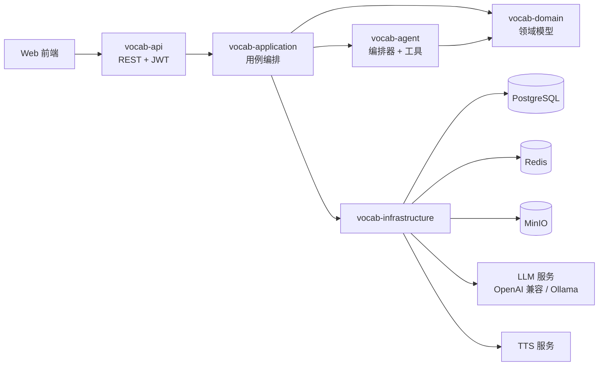
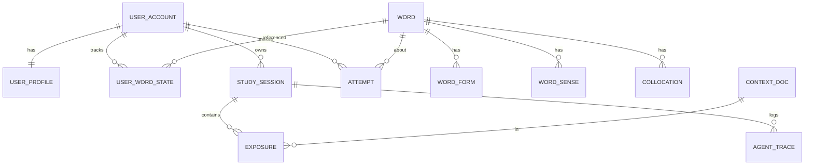
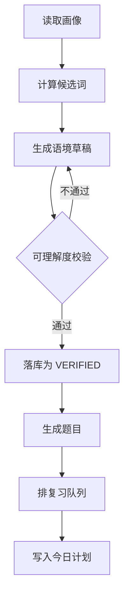
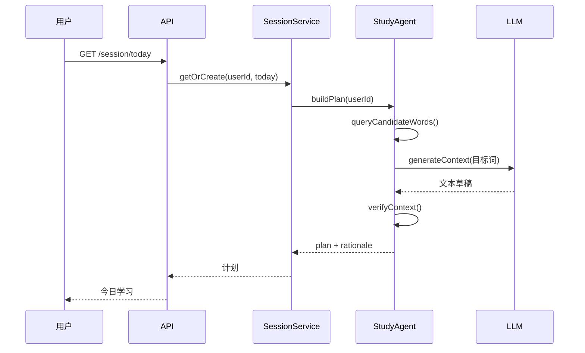
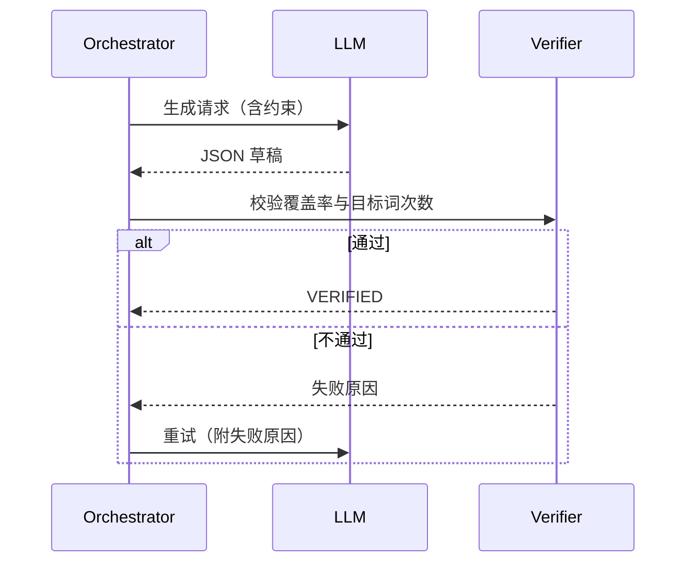

# 基于智能体的个性化语境式英语词汇学习平台 · 设计方案

| 项目 | 内容 |
|---|---|
| 文档版本 | v1.1 |
| 日期 | 2026-11-10 |
| 后端技术栈 | Java 21 LTS + Spring Boot 3.3+ |
| 前端技术栈 | Vue 3 + TypeScript + Vite + Pinia + Tailwind CSS |
| 数据存储 | PostgreSQL 16 + Redis 7 + MinIO |
| 前端形态 | 响应式 Web（后续可扩展小程序） |
| 设计依据 | NGSL 1.2 词表、《告诉你外语学习的真实方法与误区分析》、《找对英语学习方法的第一本书》、间隔重复算法长文两篇 |

---

## 1. 设计依据

### 1.1 资料盘点

| 资料 | 可用内容 | 在系统中的作用 |
|---|---|---|
| NGSL 1.2 词表 | 2809 个 NGSL 词元、47 个补充词（SUP）、955 个学术词（NAWL） | 选词与分级的底座 |
| `NGSL+with+SFI+(31K).xlsx` | 31,240 行，含 SFI 排名、SFI 值、每百万调整频次 U、分布均匀度 D、单词覆盖率、累计覆盖率 | 计算"先学谁" |
| `NGSL_1.2_with_English_definitions.xlsx` | 2809 条英文释义 | 释义兜底与英英解释 |
| `NGSL_1.2_lemmatized_for_teaching.csv` | 词元与词形对应 | 词族识别、文本词形还原 |
| 《告诉你外语学习的真实方法与误区分析》 | 常见误区清单、可理解输入、无效输入、4 秒声音缓存、发音取决于听辨 | 决定"怎么学" |
| 《找对英语学习方法的第一本书》 | 70%–80% 可懂度、20%–30% 生词、人造语言环境的可控重复、输入优先、成人习得周期 | 决定"语境难度与复现机制" |
| 《间隔重复记忆算法：e 天内，从入门到入土。》 | SM-0 / SM-2 / SM-4 经验算法，记忆三变量模型，稳定性增长 SInc，记忆复合性，DSR 模型与 SRS 模拟，SSP-MMC | 决定复习调度与卡片原子化 |
| 《KDD'22 \| 墨墨背单词：基于时序模型与最优控制的记忆算法》 | DHP 模型、2.2 亿条记忆行为数据、SSP-MMC 最优策略与离线模拟结果 | 决定调度算法的演进路线 |

### 1.2 NGSL 实测结论

按 `NGSL+with+SFI+(31K).xlsx` 的 `Coverage` 列累加，得到：

| 累计词数 | 文本覆盖率 |
|---|---|
| 500 | 74.3% |
| 1000 | 81.8% |
| 1500 | 85.8% |
| 2000 | 88.3% |
| 2500 | 90.0% |
| 2809 | 90.8% |

三条可直接用于产品的结论：

1. **覆盖率增长是强递减的**。前 1000 词买到 81.8%，后 1809 词只多买 9 个百分点。选词必须按"覆盖收益"排序，而不是按字母序或教材单元。
2. **频次高不等于该早学**。`unclear` 每百万出现 106 次，但 `D`（分布均匀度）仅 0.05，说明它高度集中在少数文本类型。D 值低于阈值的词需要降权。
3. **词表天然分层**。NGSL（通用）→ SUP（补充）→ NAWL（学术），可以直接映射为三条学习路径，不需要重新造分级体系。

### 1.3 方法论到系统机制的映射

| 资料观点 | 系统机制 |
|---|---|
| 听不懂的输入等于噪音 | 语境生成后必须做"已知词覆盖率"校验，不达标重写 |
| 材料听懂 70%–80% 最合适 | 听力材料按 75% 可懂度生成；阅读材料按 95% 已知词生成 |
| 真实环境里同一表达复现率极低 | 由系统强制同一目标词在多个语境、多个时间点复现 |
| 声音印象只保留约 4 秒 | 目标词在单篇内至少出现 2 次，且不连续；听力材料做 3 次间隔复现 |
| 输入是必要且充分条件，输出不是 | 主线是读/听后的再认与回忆，输出题只用于暴露漏洞 |
| 成人达到流利约为年龄 ÷ 6 年 | 学习目标按"可读文本比例"设定，不承诺短期流利 |
| 发音问题源于听辨 | 拼写与辨音题使用最小对立对，并提供多口音音频 |

### 1.4 资料缺口

以下内容资料区没有提供，必须在方案中补齐：

- 中文释义：NGSL 只有英文释义，需生成后人工抽检
- 例句与真实搭配：需引入语料库或由模型生成
- 音频：需 TTS 或外部发音库
- 义项拆分：NGSL 按词元组织，不区分多义项，需自建 `word_sense`
- 考试对齐（CET/IELTS/TOEFL）：需外部映射表
- 领域词表：NAWL 只有 955 个学术词，技术、商务等领域词需另行准备

### 1.5 间隔重复资料的关键结论

这两篇资料把"复习"从经验规则变成了可计算的模型，其中六条直接改变系统设计：

**1. 记忆状态是三个变量，不是一个"掌握度"。**

- 记忆稳定性 `S`：回忆概率从 100% 降到 90% 所需的时间（部分文献用半衰期，即降到 50%）
- 记忆可提取性 `R`：某一时刻的回忆概率
- 记忆难度 `D`：材料内在难度

遗忘曲线近似指数函数：

```
R(t) = exp(-t / S)
```

**2. 稳定性增长有三条已被数据验证的规律。**

- `S` 越大，稳定性增长 `SInc` 越小（负幂关系）：越熟的词越难再提升
- `R` 越低，成功后 `SInc` 越大（指数关系）：这就是间隔效应
- `D` 越大，`SInc` 越小：难词需要更多次复习

资料特别指出：当 `R = 100%` 时，`SInc` 可能低于 1，即"刚看完就重复"不仅浪费时间，还可能损害记忆。

**3. 复合记忆的稳定性低于任一子记忆。**

复合记忆的可提取性是子记忆可提取性之积，稳定性会被拉到较难的那个子记忆的水平。直接推论：**一个单词不能做成一张"词义 + 拼写 + 搭配"的复合卡**，必须拆成原子卡。这为 5.3 中四个独立掌握度字段提供了理论依据，而不是产品偏好。

**4. 经验算法的演进给出了参数先验。**

| 算法 | 机制 | 可借用之处 |
|---|---|---|
| SM-0 | 间隔 1 / 7 / 16 / 35 天，之后 ×2 | 初始间隔先验 |
| SM-2 | 引入简易度 EF（初值 2.5）与回忆评分 q | 失败后重置、成功则拉长 |
| SM-4 | 最优间隔矩阵，跨卡片共享调整经验 | 参数应随用户群体更新 |
| SM-17 | 稳定性增长 SInc 的命名与分解 | 状态转移方程的写法 |

**5. 调度可以写成"随机最短路径"。**

SSP-MMC 把每张卡的复习看作马尔可夫决策过程：状态是 `(S, D)`，动作是"下次间隔"，成本是复习耗时，目标是"在成本约束下让尽可能多的材料达到目标稳定性"。

资料给出的离线模拟参数与结果：

- 目标半衰期 360 天，模拟 1000 天，每日成本上限 600 秒
- 成功回忆计 3 秒，失败计 9 秒
- 达到 6000 个目标词：SSP-MMC 用 466 天，Anki 用 569 天，THRESHOLD 用 533 天
- 相对 THRESHOLD 节省约 12.6% 的复习时间

**6. 复习目标不该是"清空队列"。**

资料指出最大期望稳定性增长出现在 `R ≈ 30%–40%`，但这不等于最高学习效率；真正的最优解是在时间预算内最大化长期留存。因此产品的复习指标应定义为"在每日时长约束下，目标稳定性达成量"，而不是"今日待复习数归零"。

对本方案的净影响：

- 6.4 从"自造间隔公式"改为 DSR 体系，并按 P0/P1/P2 分阶段落地
- 5.3 的四维拆分从"设计选择"升级为"算法要求"
- 前端"复习"页必须展示 `S` 与 `R`，让用户理解"为什么现在复习它"

---

## 2. 产品定义

### 2.1 一句话定位

不是"背单词 App"，也不是"每天一篇外刊"。

它是**一套以可理解输入为核心的教学系统**：用你已经认识的词，搭出一篇只差一点的英文，让 8 个新词在语境里反复出现，直到你不查词典也能读懂。

特色只有一句：**每一篇都保证对你"只难一点点"，并且这个判断可以验证。**

基本盘同样齐全：词书与词表进度、生词本、闪卡复习、任意查词、离线与导出。特色决定用户为什么留下，基本盘决定用户为什么能开始。

### 2.2 目标用户

| 类型 | 特征 | 默认路径 |
|---|---|---|
| 备考型 | 有明确考试目标，时间紧 | 考试词表优先，覆盖率按考试文本校准 |
| 阅读型 | 想读英文文档、论文、新闻 | 领域词表优先，语境取真实文本风格 |
| 兴趣型 | 想看懂剧、小说、游戏 | 兴趣主题优先，语境偏叙事与对话 |
| 恢复型 | 学过多年但长期不用 | 先做测词，重排在"半生不熟"区间 |

非目标用户：零基础儿童、需要系统语法课程的学习者、以口语陪练为核心诉求的用户。

### 2.3 核心假设

1. 学习者愿意每天投入 15–25 分钟，但不愿做无上下文的词表打卡。
2. "今天该学什么"由系统算出来，比用户自己挑更有效。
3. 语境只要足够可理解，重复密度足够，词汇留存会显著优于列表记忆。
4. 用户能感知到"智能体在替我编排"，并因此更愿意坚持。

### 2.4 成功指标

| 层级 | 指标 | 目标 |
|---|---|---|
| 北极星 | 周留存 ≥ 4 天 | ≥ 35% |
| 学习效果 | 30 天后同词再认正确率 | ≥ 80% |
| 学习效果 | 目标文本未知词比例下降 | 相对下降 ≥ 15% |
| 体验 | 语境"读得下去"评分 | ≥ 4.0 / 5 |
| 特色 | 读懂率月增幅（百分点） | ≥ 2 |
| 基本盘 | 词书 30 天完成率 | ≥ 25% |
| 基本盘 | 生词本 7 日内回访率 | ≥ 40% |
| 系统 | 今日会话首屏 P95 | ≤ 300 ms |
| 系统 | 语境生成成功率（含重试） | ≥ 98% |

### 2.5 产品结构：特色层与基本盘

| 层 | 内容 | 作用 | 是否差异化 |
|---|---|---|---|
| 特色层 | 可读输入引擎：95% 已知词约束、目标词跨篇复现、读懂率曲线 | 决定留存与口碑 | 是，竞品无同等实现 |
| 基本盘 | 词书与词表进度、生词本、闪卡复习、任意查词、测词定级、离线、导出 | 决定"能不能用" | 否，做到行业平均以上即可 |
| 场景层 | 四六级冲刺 30 天、技术文档阅读 | 决定"愿不愿意开始" | 半差异化，把特色装进具体目标 |

三条约束：

1. **基本盘不复造**。词书、生词本、闪卡行业已有成熟形态，直接对齐，不投入差异化预算。
2. **特色层只做一件事**：保证并证明"这一篇对你是 i+1"。任何偏离这件事的功能都不进特色层。
3. **场景层只做两个**。先验证四六级与技术文档，不做第三个。

**为什么是教学系统而不是工具**

工具解决一次性任务，教学系统解决能力增长。本产品的差异不在"更方便地查词"，而在"替你决定读什么、读多难、什么时候再见面"。因此它需要有课程感（每日计划、阶段目标），但不能有课程病（固定课表、统一进度、章节解锁）。

判断标准：**用户每周只打开三次也能用，打开二十次也不会腻。**

### 2.6 特色：可读输入的三条承诺

特色必须能被用户当场检验，否则只是话术。对外只讲三条：

1. **只难一点点**：每篇材料的已知词 ≥ 95%，且这个数来自你的真实答题记录，不是内容标签。
2. **一定会再见**：8 个目标词在本文出现 2 次，在随后 3 篇里各出现至少 1 次。复现由系统排，不靠运气。
3. **能看见移动**：读完一篇，读懂率变化即时可见；若连续 30 天月增幅低于 2 个百分点，系统改选词策略并向用户说明。

这三条同时是可验收的功能点，也是与"每日一篇外刊""AI 生成文章"划清界限的地方：别人提供内容，我们提供**受控的难度曲线**。

---

## 3. 设计原则

| # | 原则 | 资料依据 | 系统落点 |
|---|---|---|---|
| P1 | 按覆盖收益选词 | 覆盖率强递减 | `SelectionService` 评分函数 |
| P2 | 语境必须可理解 | 无效输入理论 | `ComprehensibilityVerifier` |
| P3 | 重复由系统制造 | 真实复现率低、4 秒缓存 | 目标词多次跨语境复现 |
| P4 | 输入优先，输出检验 | 输入必要且充分 | 题型权重与主流程顺序 |
| P5 | 成人路径不照搬儿童 | 成人习得周期 | 目标设定与文案口径 |
| P6 | 卡片必须原子化 | 复合记忆稳定性低于子记忆 | 四维拆分、题型分离 |
| P7 | 特色与基本盘分账 | 教学系统先可用，再特别 | 迭代排期与预算分配（见 2.5） |

补充约束：

- **不做**统一遗忘曲线。复习间隔由 DSR 状态与目标留存率计算（见 6.4）。
- **不做**"背完即复习"。`R = 100%` 时稳定性增长可能小于 1，刚学完立刻重复是负收益。
- **不做**"每日一词"式内容流。每天的词必须来自同一份学习计划。
- **不做**纯词根词缀拆解作为主要记忆手段。词源只作为辅助锚点，不进入评分。
- **基本盘不占首屏**。首屏永远只服务"今天读什么"。
- **特色入口全站只有一个**。不做第二个"智能阅读"或"AI 精读"。

---

## 4. 总体架构

### 4.1 技术选型

| 层次 | 选型 | 说明 |
|---|---|---|
| 语言 | Java 21 LTS | 虚拟线程处理 LLM 长调用 |
| 框架 | Spring Boot 3.3+ | Web、Validation、Actuator |
| 持久层 | Spring Data JPA + `JdbcClient` | JPA 管实体，复杂统计走原生 SQL |
| 数据库 | PostgreSQL 16 | JSONB 存计划与轨迹，窗口函数做统计 |
| 缓存 | Redis 7 + Caffeine | 词典本地缓存，用户已知词位图放 Redis |
| 消息/异步 | Spring `@Async` + 虚拟线程 | MVP 不引入 MQ，后续可换 RabbitMQ |
| 对象存储 | MinIO | 音频与生成文本快照 |
| 鉴权 | Spring Security + JWT | 无状态，支持后续小程序 |
| LLM | Spring AI（OpenAI 兼容协议） | 可切换本地 Ollama 降级 |
| 文档 | springdoc-openapi | 自动生成 OpenAPI 3 |
| 迁移 | Flyway | 表结构与词库导入脚本版本化 |
| 可观测 | Micrometer + Prometheus + Grafana | 关键链路埋点 |
| 测试 | JUnit 5 + Testcontainers + k6 | 单测、集成、压测 |
| 构建 | Maven 多模块 | 按领域拆分 |

选择理由：

- 选 PostgreSQL 而非 MySQL：JSONB（学习计划、智能体轨迹）、数组（领域标签）、窗口函数（覆盖率统计）都更顺手。
- 选 JPA 而非 MyBatis：领域模型稳定，CRUD 占多数；统计查询用 `JdbcClient` 直接写 SQL，避免引入两套映射。
- 不引入 Spring Batch：词库只导入一次，`ApplicationRunner` + POI 足够；避免为一次性任务增加复杂度。

### 4.2 模块划分

```
english-vocab-server
├── vocab-common          通用返回体、异常、工具、枚举
├── vocab-domain          实体、值对象、领域服务接口
├── vocab-infrastructure  持久化、Redis、LLM 客户端、TTS、对象存储
├── vocab-application     用例编排、事务边界
├── vocab-agent           智能体编排器、工具定义、提示词
├── vocab-api             REST 控制器、鉴权、参数校验
└── vocab-bootstrap       启动类、配置、Flyway、数据导入
```

依赖方向：`api → application → domain ← infrastructure`，`agent → application`。禁止 `api` 直接依赖 `infrastructure`。

### 4.3 运行时架构



### 4.4 代码目录

```
src/main/java/com/wordscape
├── common
│   ├── ApiResponse.java
│   ├── BizException.java
│   ├── ErrorCode.java
│   └── TraceContext.java
├── domain
│   ├── word/ Word.java WordForm.java WordSense.java Collocation.java
│   ├── learner/ UserAccount.java UserProfile.java UserWordState.java
│   ├── study/ StudySession.java Exposure.java Attempt.java
│   └── context/ ContextDoc.java
├── application
│   ├── PlacementService.java
│   ├── SelectionService.java
│   ├── ContextService.java
│   ├── DrillService.java
│   ├── ReviewService.java
│   └── ReportService.java
├── agent
│   ├── StudyAgentOrchestrator.java
│   ├── tool/ (WordQueryTool, ContextTool, DrillTool, ReviewTool)
│   ├── prompt/ PromptTemplates.java
│   └── AgentTraceService.java
├── infrastructure
│   ├── persistence/ (JPA Repository, JdbcQuery)
│   ├── cache/ KnownWordBitmapCache.java
│   ├── llm/ LlmClient.java
│   ├── tts/ TtsClient.java
│   └── storage/ ObjectStorageClient.java
└── api
    ├── AuthController.java
    ├── ProfileController.java
    ├── PlacementController.java
    ├── SessionController.java
    ├── ContextController.java
    ├── ReviewController.java
    ├── ReportController.java
    └── AgentTraceController.java
```

---

## 5. 领域模型

### 5.1 核心实体

| 实体 | 说明 | 关键字段 |
|---|---|---|
| `Word` | 词元 | lemma、wordlist、sfiRank、u、dispersion、coverage、中英释义 |
| `WordForm` | 词形 | form、formType（复数/过去式/派生） |
| `WordSense` | 义项 | pos、释义、例句、义项顺序 |
| `Collocation` | 搭配 | pattern、example、频次 |
| `UserAccount` | 账号 | email、passwordHash |
| `UserProfile` | 学习画像 | goal、domain、dailyMinutes、interests、targetExam |
| `UserWordState` | 词 × 维度的原子记忆状态，一个词四行 | dimension、mastery、stability(S)、difficulty(D)、nextDueAt |
| `ContextDoc` | 语境文本 | theme、body、wordCount、knownRatio、targetWordIds、status |
| `StudySession` | 每日会话 | sessionDate、planJson、status |
| `Exposure` | 曝光记录 | wordId、contextId、modality、position |
| `Attempt` | 作答记录 | wordId、itemType、isCorrect、errorType、responseMs |
| `AgentTrace` | 智能体轨迹 | step、rationale、toolName、latency、tokens |

### 5.2 ER 图



### 5.3 表设计

```sql
-- 词库
CREATE TABLE word (
    id                  BIGSERIAL PRIMARY KEY,
    lemma               VARCHAR(64)  NOT NULL UNIQUE,
    wordlist            VARCHAR(16),              -- NGSL / SUP / NAWL / EXT
    sfi_rank            INTEGER,
    sfi                 NUMERIC(6,2),
    u_per_million       NUMERIC(10,3),
    dispersion          NUMERIC(4,3),
    coverage            NUMERIC(8,6),
    cumulative_coverage NUMERIC(8,6),
    phonetic_uk         VARCHAR(64),
    phonetic_us         VARCHAR(64),
    audio_url           VARCHAR(255),
    cefr                VARCHAR(4),
    definition_en       TEXT,
    definition_zh       TEXT,
    domain_tags         TEXT[],
    created_at          TIMESTAMPTZ NOT NULL DEFAULT now()
);
CREATE INDEX idx_word_rank ON word (wordlist, sfi_rank);
CREATE INDEX idx_word_u ON word (u_per_million DESC);

CREATE TABLE word_form (
    id         BIGSERIAL PRIMARY KEY,
    word_id    BIGINT NOT NULL REFERENCES word(id),
    form       VARCHAR(64) NOT NULL,
    form_type  VARCHAR(16) NOT NULL,
    UNIQUE (word_id, form)
);
CREATE INDEX idx_form ON word_form (form);

CREATE TABLE word_sense (
    id            BIGSERIAL PRIMARY KEY,
    word_id       BIGINT NOT NULL REFERENCES word(id),
    pos           VARCHAR(16),
    definition_zh TEXT,
    definition_en TEXT,
    example       TEXT,
    sense_order   SMALLINT NOT NULL DEFAULT 1
);

CREATE TABLE collocation (
    id        BIGSERIAL PRIMARY KEY,
    word_id   BIGINT NOT NULL REFERENCES word(id),
    pattern   VARCHAR(128) NOT NULL,
    example   TEXT,
    frequency INTEGER DEFAULT 0
);

-- 学习者
CREATE TABLE user_account (
    id            BIGSERIAL PRIMARY KEY,
    email         VARCHAR(128) NOT NULL UNIQUE,
    password_hash VARCHAR(100) NOT NULL,
    nickname      VARCHAR(64),
    created_at    TIMESTAMPTZ NOT NULL DEFAULT now()
);

CREATE TABLE user_profile (
    user_id        BIGINT PRIMARY KEY REFERENCES user_account(id),
    goal           VARCHAR(16)  NOT NULL,   -- EXAM / READING / INTEREST / RECOVERY
    domain         VARCHAR(64),
    target_exam    VARCHAR(16),
    daily_minutes  SMALLINT NOT NULL DEFAULT 20,
    interests      JSONB NOT NULL DEFAULT '[]',
    known_estimate INTEGER NOT NULL DEFAULT 0,
    known_ci_low   INTEGER,
    known_ci_high  INTEGER,
    updated_at     TIMESTAMPTZ NOT NULL DEFAULT now()
);

-- 每个"词 × 维度"一行，对应一张原子记忆卡（见 6.4.2）
CREATE TABLE user_word_state (
    user_id         BIGINT NOT NULL REFERENCES user_account(id),
    word_id         BIGINT NOT NULL REFERENCES word(id),
    dimension       VARCHAR(16) NOT NULL,          -- RECOGNITION / RECALL / SPELLING / COLLOCATION
    mastery         SMALLINT NOT NULL DEFAULT 0,   -- 0-100，用于展示与选词
    stability       REAL     NOT NULL DEFAULT 0,   -- S，天
    difficulty      REAL     NOT NULL DEFAULT 0.3, -- D，0-1
    exposures       INTEGER  NOT NULL DEFAULT 0,
    lapses          INTEGER  NOT NULL DEFAULT 0,
    first_seen_at   TIMESTAMPTZ,
    last_seen_at    TIMESTAMPTZ,
    next_due_at     TIMESTAMPTZ,
    PRIMARY KEY (user_id, word_id, dimension)
);
CREATE INDEX idx_due ON user_word_state (user_id, next_due_at);

-- 学习过程
CREATE TABLE context_doc (
    id              BIGSERIAL PRIMARY KEY,
    theme           VARCHAR(32) NOT NULL,
    difficulty      VARCHAR(16) NOT NULL,     -- A2 / B1 / B2 / C1
    body            TEXT NOT NULL,
    word_count      INTEGER NOT NULL,
    known_ratio     NUMERIC(5,4) NOT NULL,
    target_word_ids BIGINT[] NOT NULL,
    source          VARCHAR(16) NOT NULL,     -- AGENT / TEMPLATE / HUMAN
    model_name      VARCHAR(64),
    prompt_version  VARCHAR(16),
    status          VARCHAR(16) NOT NULL,     -- DRAFT / VERIFIED / REJECTED
    created_at      TIMESTAMPTZ NOT NULL DEFAULT now()
);

CREATE TABLE study_session (
    id           BIGSERIAL PRIMARY KEY,
    user_id      BIGINT NOT NULL REFERENCES user_account(id),
    session_date DATE NOT NULL,
    plan_json    JSONB NOT NULL,
    status       VARCHAR(16) NOT NULL DEFAULT 'PLANNED',
    created_at   TIMESTAMPTZ NOT NULL DEFAULT now(),
    UNIQUE (user_id, session_date)
);

CREATE TABLE exposure (
    id          BIGSERIAL PRIMARY KEY,
    session_id  BIGINT NOT NULL REFERENCES study_session(id),
    user_id     BIGINT NOT NULL,
    word_id     BIGINT NOT NULL REFERENCES word(id),
    context_id  BIGINT REFERENCES context_doc(id),
    modality    VARCHAR(8) NOT NULL,          -- READ / LISTEN
    position    INTEGER,
    created_at  TIMESTAMPTZ NOT NULL DEFAULT now()
);
CREATE INDEX idx_exposure_user_word ON exposure (user_id, word_id, created_at DESC);

CREATE TABLE attempt (
    id          BIGSERIAL PRIMARY KEY,
    client_id   VARCHAR(64) NOT NULL UNIQUE,  -- 幂等键
    user_id     BIGINT NOT NULL,
    word_id     BIGINT NOT NULL REFERENCES word(id),
    item_type   VARCHAR(24) NOT NULL,
    is_correct  BOOLEAN NOT NULL,
    error_type  VARCHAR(24),
    response_ms INTEGER,
    created_at  TIMESTAMPTZ NOT NULL DEFAULT now()
);

CREATE TABLE agent_trace (
    id          BIGSERIAL PRIMARY KEY,
    session_id  BIGINT NOT NULL REFERENCES study_session(id),
    step        VARCHAR(32) NOT NULL,
    tool_name   VARCHAR(64),
    rationale   TEXT,
    payload     JSONB,
    latency_ms  INTEGER,
    token_in    INTEGER,
    token_out   INTEGER,
    created_at  TIMESTAMPTZ NOT NULL DEFAULT now()
);

CREATE TABLE daily_metric (
    user_id          BIGINT NOT NULL,
    metric_date      DATE NOT NULL,
    new_words        INTEGER NOT NULL DEFAULT 0,
    reviews          INTEGER NOT NULL DEFAULT 0,
    accuracy         NUMERIC(5,4),
    known_estimate   INTEGER,
    coverage_ratio   NUMERIC(5,4),
    PRIMARY KEY (user_id, metric_date)
);
```

### 5.4 词库导入

- 读取 `NGSL+with+SFI+(31K).xlsx` 的 `SFI adj` 工作表，按 `WL_SFI_Rank` 排序写入 `word`
- `Wordlist` 为空的词记为 `EXT`，只作为候选词，不进入默认学习路径
- 读取 `NGSL_1.2_with_English_definitions.xlsx` 回填 `definition_en`
- 读取 `NGSL_1.2_lemmatized_for_teaching.csv` 写入 `word_form`
- 导入任务用 `ApplicationRunner` + 幂等 upsert（`ON CONFLICT (lemma) DO UPDATE`），可重复执行
- 中文释义、音标、音频通过离线批处理补充，缺失时前端降级显示英文释义

---

## 6. 核心算法

### 6.1 已知词量估计

**目标**：在不做 2809 题的前提下，估计用户已掌握的词量与覆盖曲线。

**流程**：

1. 从 NGSL 按 SFI 排名分 10 层，每层抽 4 词，共 40 题（含 4 个伪词用于检测乱答）。
2. 每题给出词 + 四个中文释义选项。
3. 每层正确率 `p_i` 作为该层的掌握比例。
4. 用一参数 Logistic（Rasch）拟合曲线：

```
P(known | rank) = 1 / (1 + exp((rank - θ) / s))
```

- `θ`：用户水平参数，用最大似然估计
- `s`：斜率，初始取 600，后续用全体用户数据回归

5. 已知词量：

```
known = Σ_{rank=1..2809} P(known | rank)
```

6. 覆盖率：把 `P(known)` 与每个词的 `coverage` 相乘后累加。
7. 置信区间：对 40 题做 1000 次 bootstrap，取 2.5% 与 97.5% 分位。

**冷启动兜底**：用户跳过测试时，按目标与自评水平给初始 `θ`，之后用答题结果持续校正。

### 6.2 选词

**候选池**：

- 该用户 `user_word_state` 中不存在的 NGSL 词
- 目标领域差集词（NAWL 或领域词表，且不在已知集合）
- 排除 `dispersion < 0.3` 且与用户目标无关的词

**评分函数**：

```
score(w) = log(1 + U_w)
         × D_w^0.5
         × goalWeight(w)
         × (1 - mastery(w))
         × freshness(w)
         × typeBalance(w)
```

| 因子 | 计算 |
|---|---|
| `U_w` | 每百万频次，做对数压缩，避免 the/be 类词垄断 |
| `D_w` | 分布均匀度，开方后使用，惩罚单一领域高频词 |
| `goalWeight` | 目标相关词 ×3，通用词 ×1，无关领域词 ×0.5 |
| `mastery` | 四维掌握度加权平均：再认 0.4、回忆 0.3、拼写 0.2、搭配 0.1 |
| `freshness` | `exp(-近 7 天曝光次数 / 3)`，防止反复推同一批词 |
| `typeBalance` | 同一词性、同一语义簇超过 2 个时降权 |

**硬约束**：

- 每日新词 6–10 个，按 `dailyMinutes` 调整
- 同一语义簇最多 2 个
- 新词难度只取用户当前水平上一层（i+1）
- 复习词优先于新词，复习未完成时新词最多 5 个

**输出**：按分数降序取 N 个，同时返回每个词的入选理由，供智能体解释。

### 6.3 语境生成与校验

**输入**：目标词集合、用户兴趣、已知词集合、难度、篇幅、模态。

**生成约束**（写入提示词）：

- 目标词 6–10 个，每个至少出现 2 次
- 已知词覆盖率 ≥ 95%（阅读）/ 可懂度 ≥ 75%（听力）
- 平均句长 ≤ 22 词
- 不出现未列入目标词的低频词
- 文体由兴趣决定：科幻、职场、旅行、体育等

**校验器**（`ComprehensibilityVerifier`）：

```
1. 分词 → 词形还原 → 映射到 word_id
2. 过滤专有名词、数字、标点
3. knownRatio = 已知词数 / 实词总数
4. 校验每个目标词出现次数 ≥ 2
5. 校验平均句长、生词密度、禁用词
6. 任一项不通过 → 返回具体原因，重试
```

**重试策略**：

- 最多重试 3 次
- 第 2 次起把失败原因追加进提示词
- 3 次仍失败 → 降级为模板语境（从预置语料里选最接近的），并标记 `source=TEMPLATE`
- 所有生成结果存 `context_doc`，通过校验才置 `VERIFIED`

### 6.4 复习调度

**理论基座**：DSR 三变量模型。每个"词 × 维度"是一个原子记忆对象，独立维护 `S`、`D`、`R`。

#### 6.4.1 状态定义

| 变量 | 含义 | 单位 |
|---|---|---|
| `S` | 记忆稳定性，回忆概率从 100% 降到 90% 所需时间 | 天 |
| `D` | 记忆难度，0–1，越大越难 | 无量纲 |
| `R` | 可提取性，当前回忆概率 | 0–1 |

```
R(t) = exp(-t / S)
```

`t` 为距上次成功复习的天数。`R` 不落库，按需计算；`S`、`D` 落库。

#### 6.4.2 原子化

资料结论：复合记忆的可提取性是子记忆之积，稳定性会被拉到较难的子记忆水平。因此一个单词拆成四张原子卡：

| 原子卡 | 题型 | 初始 S | 目标 R | S 上限（天） |
|---|---|---|---|---|
| 再认 | 见词选义 | 1.0 | 0.90 | 180 |
| 回忆 | 中文想词 | 0.8 | 0.88 | 180 |
| 拼写 | 听音拼写 | 0.4 | 0.85 | 90 |
| 搭配 | 语境填空 | 0.6 | 0.85 | 120 |

同一单词的四种卡不同时出现，避免又把复合记忆拼回去。

#### 6.4.3 状态转移

P0 采用 DSR 的工程化简化式，参数先验来自 SM-2 / SM-4，上线后用真实日志拟合：

成功（`result = 1`）：

```
S' = S × (1 + a × (1 - R) × (11 - D) / 10 × S^(-b))
```

失败（`result = 0`）：

```
S' = max(0.5, c × S × D^(-d))
D' = min(1, D + e)
```

先验参数：

| 参数 | 初值 | 含义 |
|---|---|---|
| `a` | 1.2 | 成功增益系数 |
| `b` | 0.2 | 稳定性的边际递减 |
| `c` | 0.35 | 失败后的稳定性保留比例 |
| `d` | 0.5 | 难度对失败的放大 |
| `e` | 0.05 | 每次失败增加的难度 |

性质校验（必须由单测覆盖）：

- `R → 0` 时 `S'` 更大，符合间隔效应
- `R → 1` 时 `S' → S`，不出现"刚复习就暴涨"
- `D → 1` 时 `S'` 更小，难词增益低
- 失败后 `S' < S`，且不低于 0.5 天

#### 6.4.4 间隔计算

```
interval = -S' × ln(targetR)
next_due = now + clamp(interval, 1, S上限) 天
```

例：再认卡 `S' = 6.2`，`targetR = 0.90`，间隔为 `-6.2 × ln(0.9) ≈ 0.65` 天，向上取 1 天；`S' = 60` 时约 6.3 天。

#### 6.4.5 每日队列

排序依据是"单位时间收益"，而不是逾期天数：

```
benefit = (1 - R_now) × gapWeight × goalWeight
cost    = R_now × 3s + (1 - R_now) × 9s     // 资料中的成功/失败成本假设
priority = benefit / cost
```

- 队列上限由 `dailyMinutes` 换算，默认 20–30 张卡
- 同一单词最多出现两张不同维度的卡
- 连续成功且 `S > 30` 的卡降级为抽查，不再进入每日队列

#### 6.4.6 三阶段演进

| 阶段 | 方案 | 说明 |
|---|---|---|
| P0 | DSR-lite | 上述公式 + 先验参数，跑通闭环 |
| P1 | 参数拟合 | 用答题日志按用户分层拟合 `a/b/c/d/e`，冷启动用群体参数 |
| P2 | SSP-MMC 策略表 | 离线值迭代求 `(S, D) → 最优间隔`，线上查表；目标稳定性 360 天 |

P2 的做法：把 `S` 按 `log` 分箱离散化，`D` 分 10 档，动作空间取 20 个候选间隔，用贝尔曼方程迭代至策略收敛；每次成本按成功 3 秒、失败 9 秒计。策略表随参数版本发布，不要求线上实时求解。

### 6.5 漏洞归因

错误类型枚举：

| 类型 | 判定方式 | 后续题型 |
|---|---|---|
| `MEANING` | 释义选错，且非形近干扰 | 语境再认 |
| `SPELLING` | 拼写编辑距离 ≤ 2 | 听音拼写 |
| `COLLOCATION` | 搭配填空错 | 短语填空、改错 |
| `SYNTAX` | 句子结构理解错 | 长句拆解 |
| `LOOKALIKE` | 与形近词混淆 | 最小对立对辨析 |
| `SPECIAL_SENSE` | 熟词僻义 | 多义项对照 |

归因后写入 `attempt.error_type`，同时提高对应维度的复习权重。

---

## 7. 智能体设计

### 7.1 职责边界

智能体**只做编排与解释**，不做以下事情：

- 不直接改数据库，所有写操作走应用服务
- 不自由生成词表，候选词必须来自 `SelectionService`
- 不跳过校验，生成的语境必须过 `ComprehensibilityVerifier`

### 7.2 工具清单

| 工具 | 入参 | 出参 | 用途 |
|---|---|---|---|
| `getLearnerProfile` | userId | 目标、兴趣、已知词量 | 编排上下文 |
| `estimateKnownWords` | userId | 估计值与区间 | 冷启动 |
| `queryCandidateWords` | userId, limit | 候选词及评分 | 选词 |
| `getWordDetail` | lemma | 释义、词形、搭配 | 生成语境 |
| `generateContext` | 目标词、主题、难度 | 文本草稿 | 生成 |
| `verifyContext` | 文本、目标词 | 覆盖率、问题列表 | 校验 |
| `buildDrillItems` | 词、漏洞类型、数量 | 题目列表 | 出题 |
| `scheduleReviews` | userId, 日期 | 复习队列 | 调度 |
| `composeReport` | userId, 日期 | 指标与解读 | 报告 |

工具用 Spring AI 的 `@Tool` 注解声明，参数用 record + `@JsonPropertyDescription`。

### 7.3 编排流程



每一步都写 `agent_trace`，包括 `rationale`。

### 7.4 提示词与结构化输出

系统提示词骨架：

```
你是英语词汇学习编排器。
约束：
1. 只能使用给定目标词，不得引入其他低频词。
2. 目标词每个至少出现 2 次，间隔不少于 1 句。
3. 句子平均长度不超过 22 词。
4. 不使用超出 B2 的语法结构。
5. 输出必须是 JSON，不要解释。
```

用户消息包含：目标词及释义、用户兴趣、难度、篇幅、上一次失败原因（重试时）。

输出 Schema：

```json
{
  "title": "string",
  "body": "string",
  "targetWords": ["string"],
  "sentences": 12,
  "estimatedDifficulty": "B1"
}
```

用 Spring AI 的 `BeanOutputConverter` 直接反序列化为 record，反序列化失败按生成失败处理。

### 7.5 可解释性

每个学习计划返回 `rationale` 列表，例如：

```
今天选了 8 个词：
- 6 个来自你目标文档中的高频未知词（合计覆盖 3.2%）
- 2 个是你上周答错 2 次以上的词
- 语境已知词占比 95.4%，符合可理解输入阈值
- 3 个拼写薄弱词被安排在明早复习
```

前端在"今日学习"页用可展开的决策条展示。

### 7.6 降级与成本

- **缓存**：以 `hash(目标词集合 + 主题 + 难度)` 为键缓存语境，命中率目标 ≥ 40%
- **批量预生成**：每天凌晨为活跃用户预生成次日语境
- **超时与熔断**：LLM 超时 20s，重试 2 次，Resilience4j 熔断
- **降级链**：LLM → 模板语境 → 预置语料（冲刺模式直接走真题句，不生成）
- **不阻塞**：生成失败先返回模板文，后台补生成；前端不出现等待动画
- **成本控制**：单用户单日 token 上限，超限后只走模板

---

## 8. 接口设计

### 8.1 约定

- 基础路径：`/api/v1`
- 鉴权：`Authorization: Bearer <jwt>`
- 统一返回：

```json
{
  "code": 0,
  "message": "ok",
  "data": {},
  "traceId": "b1f2c3"
}
```

- 幂等：写接口接受 `clientId`，重复提交返回首次结果
- 分页：`page`、`size`，默认 20

### 8.2 接口清单

| 方法 | 路径 | 说明 |
|---|---|---|
| POST | `/auth/register` | 注册 |
| POST | `/auth/login` | 登录 |
| GET | `/me/profile` | 学习画像 |
| PUT | `/me/profile` | 更新目标、兴趣、每日时长 |
| POST | `/placement/start` | 开始测词 |
| POST | `/placement/answer` | 提交单题 |
| GET | `/placement/result` | 测词结果与覆盖曲线 |
| GET | `/session/today` | 今日计划（含 rationale） |
| POST | `/session/{id}/start` | 开始会话 |
| GET | `/contexts/{id}` | 获取语境文本 |
| POST | `/contexts/{id}/read` | 标记已读，写入 exposure |
| POST | `/attempts` | 提交作答 |
| GET | `/reviews/today` | 今日复习队列 |
| POST | `/reviews/{wordId}` | 提交复习结果 |
| GET | `/reports/daily` | 日报 |
| GET | `/reports/overview` | 覆盖率与趋势 |
| GET | `/gaps/summary` | 六类漏洞矩阵与修复收益排序 |
| GET | `/contexts` | 语境库列表（主题、难度、篇幅筛选） |
| GET | `/agent/traces/{sessionId}` | 智能体决策轨迹 |
| GET | `/words/{lemma}` | 词条详情 |

### 8.3 示例

`GET /api/v1/session/today`

```json
{
  "code": 0,
  "message": "ok",
  "data": {
    "sessionId": 1024,
    "date": "2026-11-09",
    "estimatedMinutes": 21,
    "newWords": [
      {"lemma": "conduct", "sfiRank": 412, "reason": "目标文档高频未知词"},
      {"lemma": "approach", "sfiRank": 389, "reason": "上周答错 2 次"}
    ],
    "context": {
      "id": 8801,
      "theme": "scifi",
      "wordCount": 198,
      "knownRatio": 0.954,
      "targetCount": 8
    },
    "reviewCount": 18,
    "rationale": [
      "今日新词全部来自你的目标文档差集",
      "语境已知词占比 95.4%，高于 95% 阈值",
      "3 个拼写薄弱词已安排在明早复习"
    ]
  },
  "traceId": "b1f2c3"
}
```

`POST /api/v1/attempts`

```json
{
  "clientId": "6e2f0c1a-...",
  "wordId": 412,
  "itemType": "MEANING_CHOICE",
  "isCorrect": false,
  "errorType": "LOOKALIKE",
  "responseMs": 4300
}
```

---

## 9. 关键流程时序

### 9.1 每日会话



### 9.2 语境生成与校验



---

## 10. 前端设计

### 10.1 设计目标

#### 10.1.1 一句话

让一个晚上十一点、只剩 20 分钟、已经对背单词失望过一次的人，**不用做任何决定就能开始，并且在 15 分钟内读完一篇真的能读懂的文章**。

#### 10.1.2 三条可测目标

| 目标 | 指标 | 现状基线 |
|---|---|---|
| 启动快 | 打开到开始阅读 ≤ 2 次点击、≤ 10 秒 | 旧版需 4 步向导 + 40 题测词 |
| 认知轻 | 首屏可见的可交互元素 ≤ 6 个 | 旧版首屏 20+ 个 |
| 中断可恢复 | 任意页面离开后 30 秒内可回到原位 | 旧版无进度保存 |

#### 10.1.3 对 v1.0 的修正清单

| 问题 | v1.0 做法 | v2.0 做法 |
|---|---|---|
| 首启成本高 | 4 步向导 + 40 题测词 | 1 屏说明 + 15 题测词，可跳过 |
| 首屏过载 | 导航 + 正文 + 智能体决策栏三栏常驻 | 正文单栏，理由收进"?"弹层 |
| 术语负担 | 直接显示 S、R、覆盖率、六类漏洞 | 全部翻译成人话，原始数据折叠 |
| 强制顺序 | 读完才解锁训练 | 不做门禁，只做提示 |
| 入口重叠 | "今天"和"阅读"都有文章 | 阅读库收进"换一篇" |
| 报告过载 | 5 个图表块并列 | 1 个主指标 + 1 句话，其余折叠 |
| 无低能量路径 | 只有完整 20 分钟流程 | 增加 3 分钟模式 |
| 基本盘缺失 | 只有阅读与报告，没有词书、生词本、查词 | 增加词库入口、生词本与冲刺模式 |

---

### 10.2 设计原则

**P1 默认路径一屏一动作。**
每个页面在任意时刻只有一个主按钮。次级操作放文字链接或图标，不与之竞争。

**P2 渐进披露，二段展开。**
第一层只给结论（"这篇你大概能读懂"），第二层才给依据（"已知词 95.4%，目标词 8 个"），第三层给原始数据（可复制、可导出）。任何参数不超过两层。

**P3 用用户的词，不用系统的词。**
不出现"覆盖率""稳定性""S 值""维度"。翻译表见第 10 节。

**P4 不阻断。**
任何"建议"都不做成"门禁"。用户可以跳过测词、跳过理解题、随时切到低能量模式。

**P5 阅读优先。**
所有页面的视觉重心都在正文上。字号、行高、行宽按长文阅读标准设定，不为了排版美观牺牲可读性。

**P6 状态可见但不喧哗。**
学习状态用文字和细线表达，不用大面积色块、进度环、徽章堆叠。

---

### 10.3 信息架构

#### 10.3.1 一级入口（4 个）

```
今天  ── 阅读器（主）+ 冲刺/日常切换 + 低能量入口
词库  ── 词书进度、生词本、查词、词表导入（基本盘）
复习  ── 单卡流，随时可刷（基本盘）
我的  ── 目标、每日时长、提醒、进步入口、导出
```

三个入口服务特色，一个入口服务基本盘。复习必须独立：已经读完今天内容的用户，不该被迫回到今天页才能复习。

"进步"不再占一级入口，收进"我的"顶部卡片与结算页，避免第五个 tab。旧版的"阅读""漏洞""报告"继续下沉：阅读库 → 今天页"换一篇"；漏洞 → 进步页"待补的词"。

#### 10.3.2 路由表

| 路由 | 页面 | 说明 |
|---|---|---|
| `/onboarding` | 首次说明 | 1 屏，仅首次 |
| `/placement` | 测词 | 15 题，可跳过 |
| `/today` | 今天 | 默认首页 |
| `/today/read/:textId` | 阅读器 | 沉浸式，无导航栏 |
| `/library` | 词库 | 四个 tab + 搜索 |
| `/library/book/:id` | 词书详情 | 进度、筛选、批量操作 |
| `/review` | 复习 | 单卡流 |
| `/review/quick` | 低能量模式 | 10 张卡，3 分钟 |
| `/progress` | 进步 | 主指标 + 折叠详情 |
| `/me` | 我的 | 设置 |
| `/done` | 今日完成 | 结算页 |

#### 10.3.3 导航形态

- 桌面（≥ 1024px）：顶部导航，高 64px，左 logo、中四项、右头像
- 移动（< 768px）：底部标签栏，高 56px + 安全区，四项
- 阅读器、复习、测词：全屏模式，隐藏导航，仅保留左上关闭与进度

---

### 10.4 用户旅程

#### 10.4.1 首次使用（目标 ≤ 3 分钟进入阅读）

```
落地
 └ 说明页（3 句话 + 目标选择 + [开始]）
     └ 测词（15 题，右上角[跳过]）
         └ 结果（"你大约认识 1800 词，能读懂一般文章的 81%" + [读第一篇]）
             └ 阅读器
```

说明页文案：

> 每天 8 个词，一篇你几乎都认识的文章。
> 只复习快忘的，不重复已经会的。
> 你只需要读，剩下的我来安排。

目标选择三选一：**考试 / 工作与论文 / 兴趣阅读**。只影响选词权重，之后可在"我的"修改。

#### 10.4.2 日常（20 分钟）

```
打开 → 今天页（直接看到文章标题与首段）
  → [开始阅读] → 阅读器（6–8 分钟）
      → 点词查义（不跳页）
      → [读完了] → 3 道理解题（可跳过）
          → 8 词快认（每个 2 秒，二选一）
              → 结算页 → 明日预告
  → 复习提醒（若队列 ≥ 5）→ 单卡流（5 分钟）
```

#### 10.4.3 低能量（3 分钟）

今天页底部固定一行小字：`只有 3 分钟？只复习 10 个词 →`

进入后只做复习，不读新文章，不计入"今日完成"，但计入连续天数。

#### 10.4.4 中断恢复

- 阅读位置按段落记录，回到文章时定位到上次段落顶部，并显示一次轻提示"上次读到第 4 段"
- 复习进度按卡记录，重进时从下一张继续
- 未提交的选择题不保存，重做该题

---

### 10.5 页面详设

#### 10.5.1 今天（`/today`）

```
┌──────────────────────────────────────────────────────┐
│  词境          今天   进步   我的                 (头) │
├──────────────────────────────────────────────────────┤
│                                                      │
│   周四 · 第 12 天                       今日 0/3 段   │
│                                                      │
│   为什么城市在夜里更安静                               │
│   说明文 · 210 词 · 约 6 分钟 · 你大概能读懂 95%       │
│                                                      │
│   城市的夜晚并不是真的安静。它只是把白天的噪音…        │
│                                                      │
│                    [ 开始阅读 ]                       │
│                                                      │
│   今天要学 8 个词 · 为什么是这 8 个 ›                  │
│                                                      │
├──────────────────────────────────────────────────────┤
│   待复习 12 个词 · 约 4 分钟          [去复习]        │
│   只有 3 分钟？只复习 10 个词 →                       │
└──────────────────────────────────────────────────────┘
```

规则：

- 首屏只出现 **一个主按钮**（开始阅读）。复习按钮为次级样式，低能量为纯文字链接
- 文章标题上方不放大图、不放插画，避免挤压首屏
- "为什么是这 8 个"点击后打开底部弹层，列出三个理由（见 5.6）
- 今日三段：阅读、理解、快认。完成一段勾一段，用细线和小圆点，不用进度环
- 若今日已完成：整页换成完成态——一句结论 + 明日预告 + "再读一篇"

空状态（新用户未测词）：显示"先花 1 分钟，我看看你认识多少词"，主按钮改为 [开始测词]，另给 [先跳过，直接读]。

#### 10.5.2 阅读器（`/today/read/:textId`）

```
┌──────────────────────────────────────────────────────┐
│ ×                                    第 1 段 / 6      │
│                                                      │
│        为什么城市在夜里更安静                          │
│                                                      │
│   城市的夜晚并不是真的安静。它只是把白天的噪音        │
│   换成了另一种频率。空调外机的低鸣、远处货车的        │
│   胎噪、楼下便利店冰柜的压缩机，这些声音单独听        │
│   都不刺耳，叠在一起却形成了一层持续的底噪。          │
│                                                      │
│   研究者把这种现象称为「城市背景声」。它不像鸣笛      │
│   那样突然，因此很少被注意到，但长期暴露会让人        │
│   的注意力更难集中。                                  │
│                                                      │
│   ⋯                                                  │
│                                                      │
├──────────────────────────────────────────────────────┤
│  [ 听全文 ]                          [ 读完了 ]       │
└──────────────────────────────────────────────────────┘
```

排版规格：

| 项 | 值 |
|---|---|
| 正文宽度 | 680px（桌面），100% − 48px（移动） |
| 正文字号 | 19px（桌面）/ 18px（移动） |
| 行高 | 1.85 |
| 段间距 | 1.4em |
| 正文字色 | `--ink` #1C1B19 |
| 目标词 | 1.5px 虚线底边，色 `--accent`，不加背景 |
| 已查词 | 虚线下划线变为实线，色变浅 |
| 生词标记 | 左侧 3px 竖条，色 `--warn`，仅当前段可见 |

交互：

- 点目标词 → 词卡（5.3），不跳页、不遮当前段
- 长按任意词 → 查词（非目标词也可查），长按 300ms 触发
- 选中文本 → 仅提供"复制"，不提供"翻译"，避免打断
- 底部进度条随滚动推进，高 2px
- 关闭时若未读完，弹一次确认："已经读了 4 段，要保存进度吗？"（默认保存，不再询问）

朗读：`听全文` 调 TTS，播放时当前句高亮，可暂停、可 0.8×/1.0×。

#### 10.5.3 词卡（WordSheet）

桌面为右侧浮层（360px，贴边，不遮正文），移动为底部抽屉（85vh）。

```
┌────────────────────────────┐
│ ambient              ×     │
│ /ˈæmbiənt/          🔊     │
│                            │
│ 周围的、环境中的            │
│                            │
│ 本文中：                   │
│ 城市背景声（ambient noise） │
│                            │
│ 词形  ambience · ambiences │
│ 出现  本文 2 次 · 你见过 1 次│
│                            │
│ [ 还不熟 ]      [ 记住了 ]  │
└────────────────────────────┘
```

规则：

- 默认只显示：单词、音标、发音、一句中文释义、本文中的意思
- 词形、出现次数折叠在"更多"里
- "记住了 / 还不熟"直接写入词状态，并 toast 一句"已标记"
- 同一次阅读中重复点同一个词，不再重复弹动画，直接定位
- 词卡高度不超过可视区 70%，超出内部滚动

#### 10.5.4 理解题（阅读后）

3 题，全部是内容理解，不是词义选择。

```
第 2 题 / 共 3 题

作者认为城市夜晚"安静"的原因是：
  ○ 夜晚车流减少
  ○ 噪音变成了持续的背景声
  ○ 人们习惯了噪音
  ○ 建筑隔音变好

                        [ 下一题 ]
```

规则：

- 单选，点击即锁定，正确答案绿色文字，错误答案红色并配一句解释（不给"你错了"这种措辞）
- 右上角始终有"跳过本节"
- 3 题全错不惩罚，不显示分数，只记录到漏洞
- 答对不播撒花动效，只做 200ms 的对勾淡入

#### 10.5.5 8 词快认

每个词 2 秒，二选一，不做选择题。

```
┌────────────────────────────┐
│                            │
│        ambient             │
│                            │
│                            │
│   [ 不认识 ]   [ 认识 ]     │
└────────────────────────────┘
```

- 键盘：`1` = 不认识，`2` = 认识
- 不显示释义，不显示对错（这是自评，不是测试）
- 8 个词过完直接进结算页

#### 10.5.6 "为什么是这 8 个"弹层

第一层只给结论，第二层给依据。

```
这 8 个词，是你目标材料里出现最多、又还没掌握的词。

依据
  在你选择的「工作与论文」场景中，这 8 个词每百万次出现 ≥ 45 次
  它们能让你多读懂约 0.4% 的英文
  其中 3 个是你最近答错过的

查看完整依据 ›
```

"查看完整依据"跳进步页的选词明细，展示频次、分布、上次结果。不在此处堆参数。

#### 10.5.7 复习（`/review`）

单卡流，一屏一张。

```
┌──────────────────────────────────────────┐
│ ×                        今天还剩 11 张   │
│                                          │
│                                          │
│        threshold                         │
│        /ˈθreʃhəʊld/            🔊         │
│                                          │
│        第 3 次见面 · 距上次 6 天          │
│                                          │
│        [ 看答案 ]                        │
│                                          │
│                                          │
├──────────────────────────────────────────┤
│  忘了            有点印象          记得   │
└──────────────────────────────────────────┘
```

规则：

- 不显示 S、R、间隔天数，只显示"第 N 次见面 · 距上次 X 天"
- 点"看答案"后展开释义 + 一句例句，三个按钮才可用
- 三个按钮固定底部，等宽，触控高度 52px
- 键盘：`1/2/3` 对应三档，`空格` = 看答案
- 答完自动 180ms 滑出下一张，可撤销（3 秒内右下角 [撤销]）
- 队列为空：显示"今天的复习清完了"，并给一个"再练 10 个"的可选入口
- 顶部剩余数只减不增，避免焦虑；不显示总进度环

#### 10.5.8 低能量模式（`/review/quick`）

- 只取 10 张卡，跳过新词与理解题
- 卡片交互与 5.7 完全一致，减少学习成本
- 结束页一句话："3 分钟，守住了 10 个词。" + [回到今天]

#### 10.5.9 进步（`/progress`）

```
┌──────────────────────────────────────────┐
│  进步                                    │
│                                          │
│  你能读懂一般文章的                       │
│  82.4%                                   │
│  ↑ 本周 +0.6                             │
│                                          │
│  ▁▂▂▃▃▄▅▅▆                                │
│                                          │
│  按现在的速度，四周后大约 85%。           │
│                                          │
├──────────────────────────────────────────┤
│  ▸ 哪些能力在变化                        │
│  ▸ 待补的 10 个词                        │
│  ▸ 这周学了什么                          │
└──────────────────────────────────────────┘
```

规则：

- 只有一个主指标：可读比例。不放词汇量、不放打卡天数作为主指标
- 趋势线只有一条，7 点或 30 点，无网格、无图例、无坐标轴数字，hover 才显示具体值
- 三个折叠区默认收起，展开后：
  - 四项能力用横向条形（再认 / 回忆 / 拼写 / 搭配），标注"稳 / 在进步 / 需加强"，不显示百分数
  - 待补词单：10 个词 + 一句话理由 + [加入明天]
  - 本周学习：读了 5 篇、学了 38 个词、复习 96 次，纯文字
- 底部小字："数据口径：基于你读过的 12 篇文章估算"，点击展开说明

#### 10.5.10 我的（`/me`）

列表式，每组 ≤ 5 项：

- 学习目标（考试 / 工作与论文 / 兴趣）
- 每日时长（15 / 20 / 30 分钟）——影响每天新词数，不影响复习
- 提醒时间（开关 + 时间）
- 朗读音色与语速
- 字号（小 / 标准 / 大）
- 数据导出（CSV）
- 清除学习记录

危险操作二次确认，文案说明后果，不用红色大按钮，用红色文字。

#### 10.5.11 结算页（`/done`）

```
今天读完了。

8 个新词，3 个理解题，12 次复习。
你能读懂的比例：82.4% → 82.7%

明天：一篇关于「城市声音」的说明文，8 个新词。

[ 再读一篇 ]        [ 回首页 ]
```

只给一个数字变化和一句明日预告，不做成就体系。

---

#### 10.5.12 词库（`/library`）

基本盘的主入口，目标是"像词典一样可靠"，不做花活。

```
┌──────────────────────────────────────────┐
│  词库                      [ 导入词表 ]   │
│  [ 搜索单词或中文… ]                      │
│                                          │
│  在学 312  未学 1888  已掌握 620  生词本 46│
│                                          │
│  CET-6 核心词              1240 / 2200   │
│  ▓▓▓▓▓▓▓▓░░░░░░            [ 换词书 ]     │
│                                          │
│  ambient    /ˈæmbiənt/    周围的   3 天后 │
│  threshold  /ˈθreʃhəʊld/  门槛     明天   │
└──────────────────────────────────────────┘
```

- 四个 tab：在学、未学、已掌握、生词本，默认"在学"
- 列表行固定四项：词、音标、一句释义、下次复习的人话时间
- 左滑（移动）或 hover（桌面）出现操作：加入今天、标记已掌握、移出生词本
- 搜索支持中英文与前缀匹配，结果可直接查词，不进入学习队列
- 空生词本提示："阅读时点过的词会自动收进来"
- 词书进度只显示词数，不显示"你还差 960 个词"这类施压文案

#### 10.5.13 冲刺模式（四六级 30 天）

入口在今天页顶部模式切换，一个周期内不可来回切。

| 项 | 日常模式 | 冲刺模式 |
|---|---|---|
| 每日新词 | 8 | 40 |
| 语境来源 | 生成短文 | 真题句 + 词表例句，不生成 |
| 题型 | 再认、回忆、搭配 | 再认、拼写 |
| 主指标 | 读懂率 | 词表覆盖率 |
| 单日时长 | 20 分钟 | 25–30 分钟，可拆两段 |

理由：考前用户要的是覆盖面与"认得出来"，不是读得舒服；真题句同时把内容成本降到接近零。

页面差异只有三处：今天页顶部显示"第 7 / 30 天"；阅读器替换为真题句卡（一句一卡，可听）；结算页主指标换成"词表覆盖 56.4%"。

---

### 10.6 布局与响应式

#### 10.6.1 断点

| 断点 | 宽度 | 布局 |
|---|---|---|
| Desktop | ≥ 1200 | 顶部导航；正文 680px 居中；词卡右侧浮层 |
| Laptop | 1024–1199 | 同上，左右留白收窄至 32px |
| Tablet | 768–1023 | 顶部导航；正文 640px；词卡底部抽屉 |
| Mobile | < 768 | 底部标签栏；正文满宽；词卡 85vh 抽屉 |

#### 10.6.2 栅格与留白

- 基础间距单位 4px，常用 8 / 12 / 16 / 24 / 32 / 48
- 页面左右安全边距：桌面 48px，平板 32px，移动 20px
- 正文最大行宽 680px，任何情况下不超过 38 个汉字或 75 个西文单词

#### 10.6.3 移动端关键约定

- 底部标签栏 56px + `env(safe-area-inset-bottom)`
- 阅读器底部操作条固定在标签栏之上，高度 64px
- 词卡抽屉打开时，背景加 24% 遮罩并锁滚动
- 键盘弹起时（拼写题），操作条上移，正文不跳

---

### 10.7 设计 Token

#### 10.7.1 颜色

```css
:root {
  /* 底色 */
  --paper:        #FBFAF7;  /* 页面背景 */
  --surface:      #FFFFFF;  /* 卡片 */
  --surface-sunk: #F3F1EC;  /* 次级区块 */

  /* 文字 */
  --ink:          #1C1B19;  /* 正文 */
  --ink-2:        #57544E;  /* 次要文字 */
  --ink-3:        #8C877D;  /* 提示、占位 */
  --ink-inverse:  #FFFFFF;

  /* 线条 */
  --line:         #E7E3DA;
  --line-strong:  #D3CDC0;

  /* 主色：墨绿，表示"进行中/正确" */
  --accent:       #2F6B57;
  --accent-hover: #275A49;
  --accent-soft:  #EAF2ED;

  /* 语义色 */
  --warn:         #B4693B;  /* 待补、提醒 */
  --warn-soft:    #F8EEE7;
  --danger:       #A63D3D;  /* 仅用于错误与删除 */
  --danger-soft:  #F7EAEA;

  /* 阴影 */
  --shadow-1: 0 1px 2px rgba(28,27,25,.06);
  --shadow-2: 0 8px 24px rgba(28,27,25,.10);
}
```

使用约束：

- 主色只用于主按钮、目标词下划线、正确反馈，不做大面积背景
- 页面背景不用纯白，避免长时间阅读刺眼
- 不使用渐变、不使用彩色发光阴影

#### 10.7.2 字体

```css
--font-ui: "Inter", "PingFang SC", "Microsoft YaHei", system-ui, sans-serif;
--font-read: "Literata", "Source Han Serif SC", Georgia, "Songti SC", serif;
```

| 场景 | 字号 / 行高 / 字重 |
|---|---|
| 阅读正文 | 19 / 1.85 / 400 |
| 页面标题 | 28 / 1.35 / 600 |
| 卡片标题 | 20 / 1.45 / 600 |
| 界面文字 | 14 / 1.6 / 400 |
| 辅助说明 | 13 / 1.55 / 400 |
| 数字指标 | 52 / 1.05 / 600，`font-variant-numeric: tabular-nums` |

阅读字体只在阅读器与例句中使用，界面一律无衬线。

#### 10.7.3 圆角、描边、动效

- 圆角：卡片 12px，按钮 8px，输入框 8px，抽屉顶部 16px
- 描边：1px `--line`；不使用重描边卡片
- 动效时长：交互反馈 150ms，抽屉 240ms，页面切换 200ms
- 缓动：`cubic-bezier(.2,.7,.3,1)`
- 尊重 `prefers-reduced-motion`，开启时所有位移改为淡入

---

### 10.8 组件规范

#### 10.8.1 组件清单

| 组件 | 用途 | 关键状态 |
|---|---|---|
| `AppBar` | 桌面导航 | 默认 / 滚动收缩 |
| `BottomTabs` | 移动导航 | 选中 / 未选中 / 角标 |
| `PrimaryButton` | 页面主操作 | 默认 / hover / 按下 / 禁用 / loading |
| `GhostButton` | 次级操作 | 默认 / hover |
| `ReadingBody` | 正文渲染 | 默认 / 目标词 / 已查词 / 朗读高亮 |
| `WordSheet` | 词卡 | 加载 / 已查 / 已标记 / 失败 |
| `QuestionCard` | 理解题 | 未选 / 已选 / 正确 / 错误 |
| `RecallCard` | 快认 | 未选 / 已选 |
| `ReviewCard` | 复习卡 | 正面 / 已揭示 / 已评分 |
| `MetricHero` | 主指标 | 有数据 / 无数据 |
| `Sparkline` | 趋势线 | 单点 / 多点 / 空 |
| `ListRow` | 设置项 | 默认 / 禁用 / 危险 |
| `Toast` | 轻提示 | 成功 / 失败，2.4s 自动消失 |
| `EmptyState` | 空态 | 默认 / 带主按钮 |
| `StepDots` | 段进度 | 0–3 |

#### 10.8.2 关键组件规格

**PrimaryButton**

- 高度 48px，圆角 8px，左右内边距 24px
- 背景 `--accent`，文字 15px/500，白色
- 禁用：背景 `--line-strong`，文字 `--ink-3`
- loading：文字替换为三点动画，宽度不变，避免布局跳动

**ReadingBody**

- 段落内 `<span class="target-word">`，属性 `data-word-id`
- 点词触发事件，不做跳转
- 朗读时当前句加 `background: var(--accent-soft)`，150ms 过渡

**ReviewCard**

- 卡片最大宽度 520px，最小高度 360px
- 词 32px/600，音标 15px `--ink-3`，例句 17px/1.7
- 三按钮等宽，间距 8px，高度 52px
- 只有"记得"用主色描边，"忘了"用 `--ink-2` 描边，避免暗示

**Sparkline**

- 宽 100%，高 64px，线宽 2px，色 `--accent`
- 端点 3px 圆点，最后一帧带一圈 6px 的浅色光晕
- 无坐标轴、无网格；仅 hover/tap 显示数值气泡

---

### 10.9 交互规范

| # | 规则 | 说明 |
|---|---|---|
| 1 | 点词不跳页 | 词卡以浮层/抽屉出现，正文位置不变 |
| 2 | 一个页面一个主按钮 | 其余操作用次级样式或文字链接 |
| 3 | 提交即可撤销 | 复习评分与"还不熟"标记支持 3 秒内撤销 |
| 4 | 不打断的提示 | 除删除类操作外，不使用 modal 确认 |
| 5 | 加载用骨架 | 超过 300ms 显示骨架屏，不用转圈遮罩 |
| 6 | 错误就地提示 | 词卡加载失败在卡内重试，不弹全局错误 |
| 7 | 键盘可达 | 复习 `1/2/3` 与空格；阅读 `J/K` 翻段；`Esc` 关闭浮层 |
| 8 | 焦点不丢 | 关闭浮层后焦点回到触发词 |
| 9 | 滚动锁定 | 抽屉打开时锁 body 滚动，关闭后恢复位置 |
| 10 | 触控目标 ≥ 44px | 包括词旁的小图标 |

---

### 10.10 文案规范

#### 10.10.1 术语翻译表

| 系统概念 | 界面用语 |
|---|---|
| 可读文本覆盖率 82.4% | 你能读懂一般文章的 82.4% |
| 语境已知词覆盖率 95.4% | 这篇你大概能读懂 |
| 稳定性 S = 6.2d | 距上次 6 天 |
| 可提取性 R = 0.83 | （不显示，必要时写"快忘了"） |
| 遗忘风险高 | 快忘了 |
| 掌握度 / 四维状态 | 认识 / 会写 / 会用 |
| 漏洞（词义/拼写/搭配/句法/形近/僻义） | 还不熟的地方 |
| 选词评分 | 为什么是这 8 个 |
| 调度队列 | 今天还剩 11 张 |
| 智能体 | （前台不出现该词，统一说"我"） |

#### 10.10.2 语气

- 陈述事实，不评价用户："这篇你大概能读懂"，不说"你的水平还不行"
- 不制造焦虑："今天还剩 11 张"，不用"你已落后 3 天"
- 不用感叹号，不用"太棒了""加油"
- 数字保留一位小数，百分比取整

#### 10.10.3 关键文案

| 场景 | 文案 |
|---|---|
| 开始阅读 | 开始阅读 |
| 读完 | 读完了 |
| 跳过理解 | 跳过本节 |
| 复习空态 | 今天的复习清完了 |
| 今日完成 | 今天读完了。 |
| 低能量入口 | 只有 3 分钟？只复习 10 个词 → |
| 加载失败 | 没加载出来，再试一次 |
| 无网络 | 现在没有网络，已切换到缓存的文章 |
| 删除确认 | 删除后学习记录无法恢复。确定删除？ |

---

### 10.11 状态与异常

| 状态 | 处理 |
|---|---|
| 首次加载 | 正文骨架屏（3 段灰条），顶部标题占位 |
| 语境生成失败 | 自动降级为模板文章，页脚小字提示"本文为备用内容" |
| 词卡请求失败 | 卡内显示"再试一次"，保留单词与音标 |
| 音频不可用 | 隐藏喇叭图标，不显示禁用态 |
| 离线 | 使用本地缓存的今日文章与词卡；复习可离线进行，联网后补传 |
| 今日无新词 | 显示"今天的词都学完了"，提供"再读一篇" |
| 复习队列为空 | 空态 + "再练 10 个" |
| 数据不足（新用户） | 进步页显示"读完 3 篇后，这里会出现你的第一条曲线" |
| 超时（> 10s） | 显示"换个网络试试"，并提供重试与返回 |

---

### 10.12 可访问性

- 正文与背景对比度 ≥ 7:1，辅助文字 ≥ 4.5:1
- 所有交互元素有可见焦点环：2px `--accent` + 2px offset
- 图片与图标按钮必须有 `aria-label`
- 理解题反馈用 `aria-live="polite"` 播报
- 支持系统字号放大至 200% 不破版（正文用 `rem`）
- 不用颜色单独传达状态：正确/错误同时给图标与文字
- 朗读功能提供文字稿，不做纯音频内容

---

### 10.13 前端工程结构

#### 10.13.1 技术栈

- Vue 3.4 + TypeScript + Vite
- Pinia（状态）、Vue Router（路由）
- 原生 CSS 变量 + 少量 scoped CSS，不引入 UI 组件库（避免覆盖成本）
- `@vueuse/core` 处理滚动、媒体查询、本地存储
- 测试：Vitest + Playwright（关键路径 6 条）

#### 10.13.2 目录

```
frontend/
├─ src/
│  ├─ api/            # 请求封装，按域拆：today/review/progress/word
│  ├─ assets/
│  ├─ components/
│  │  ├─ base/        # Button, Toast, EmptyState, StepDots
│  │  ├─ reading/     # ReadingBody, TargetWord, WordSheet, AudioBar
│  │  ├─ review/      # ReviewCard, RatingBar, QuickReview
│  │  └─ progress/    # MetricHero, Sparkline, BarList
│  ├─ composables/    # useReadingProgress, useWordLookup, useKeyboard
│  ├─ pages/          # Today, Reader, Review, Progress, Me, Onboarding, Placement, Done
│  ├─ stores/         # user, today, reading, review, progress, ui
│  ├─ styles/         # tokens.css, base.css, typography.css
│  └─ utils/          # format, storage, text
└─ e2e/
```

#### 10.13.3 Store 职责

| Store | 持有 | 不持有 |
|---|---|---|
| `user` | 目标、时长、字号、提醒设置 | 学习统计数据 |
| `today` | 今日文章摘要、三段完成状态、8 词清单 | 文章正文（页面级请求） |
| `reading` | 当前段、已查词、词卡开关、朗读状态 | 词库数据 |
| `review` | 队列、当前索引、评分结果、撤销栈 | 复习算法（服务端算） |
| `progress` | 主指标、趋势、四维、待补词 | 原始答题日志 |
| `ui` | toast、抽屉、全局 loading | 业务数据 |

原则：服务端是唯一事实来源，store 只做会话级缓存与乐观更新；评分先本地推进，失败回滚。

#### 10.13.4 接口映射

| 页面 | 接口 | 说明 |
|---|---|---|
| 今天 | `GET /api/v1/today` | 文章摘要 + 8 词 + 三段状态 |
| 阅读器 | `GET /api/v1/contexts/{id}` | 正文、目标词位置、音频地址 |
| 词卡 | `GET /api/v1/words/{lemma}` | 释义、音标、词形、本文义 |
| 标记 | `POST /api/v1/words/{lemma}/mark` | 记住 / 还不熟 |
| 理解题 | `POST /api/v1/contexts/{id}/quiz/submit` | 逐题提交 |
| 快认 | `POST /api/v1/recall/batch` | 8 条批量 |
| 复习 | `GET /api/v1/review/queue` | 队列 + 剩余数 |
| 评分 | `POST /api/v1/review/{cardId}/grade` | 三档 |
| 进步 | `GET /api/v1/progress/overview` | 主指标 + 趋势 + 四维 |
| 待补词 | `GET /api/v1/progress/gaps` | 10 词 + 理由 |
| 测词 | `GET /api/v1/placement/next`、`POST /submit` | 15 题自适应 |
| 设置 | `PATCH /api/v1/users/me` | 目标、时长、字号 |

#### 10.13.5 性能预算

| 项 | 目标 |
|---|---|
| 首屏 LCP | < 1.5s（4G） |
| 路由切换 | < 300ms |
| 词卡响应 | < 400ms（命中缓存 < 50ms） |
| 阅读字体加载 | 用 `font-display: swap`，文本先渲染 |
| 首包 | < 200KB gzip |

#### 10.13.6 埋点（只记 8 个）

`app_open`、`read_start`、`read_finish`、`word_tap`、`quiz_skip`、`review_finish`、`quick_mode_enter`、`day_complete`

每个事件只带：用户 id 哈希、页面、时间戳、耗时。不做全量点击热图。

---

### 10.14 验收清单

#### 10.14.1 首启

- [ ] 新用户从落地到开始阅读 ≤ 3 次点击
- [ ] 测词可跳过，跳过不阻塞阅读
- [ ] 测词 15 题完成时间中位数 ≤ 90 秒

#### 10.14.2 日常

- [ ] 今天页首屏可交互元素 ≤ 6 个
- [ ] 阅读页点词不改变滚动位置
- [ ] 读完 → 结算 ≤ 4 步
- [ ] 中断后回到阅读器定位到上次段落

#### 10.14.3 复习

- [ ] 复习卡不出现 S/R/天数等参数
- [ ] 评分后 3 秒内可撤销
- [ ] 队列清空有明确结束态，不自动跳转

#### 10.14.4 进步

- [ ] 首屏只有一个主指标与一条趋势线
- [ ] 其余三块默认折叠
- [ ] 每个数字可展开到口径说明

#### 10.14.5 可用性测试（5 人）

任务：

1. 找到今天要读的文章并开始阅读
2. 查一个不认识的词，然后回到原段落
3. 完成一次复习，并说明"为什么是今天"
4. 找到"我最近进步在哪"
5. 只想花 3 分钟时，找到对应入口

通过标准：5 人全部在 60 秒内完成 1、2、3、5；4 在 90 秒内完成且能说出主指标含义。

---

## 11. 非功能设计

| 维度 | 方案 |
|---|---|
| 性能 | 读接口 P95 ≤ 300ms；语境生成异步，前端轮询或 SSE |
| 缓存 | 词库 Caffeine 本地缓存；用户已知词用 RoaringBitmap 存 Redis |
| 并发 | Java 21 虚拟线程处理 LLM 调用；`@Async` 预生成 |
| 幂等 | `attempt.client_id` 唯一约束；重复提交返回首次结果 |
| 限流 | 登录、测词、生成接口按用户维度限流 |
| 安全 | BCrypt 存密码；JWT 短过期 + Refresh Token；接口级 RBAC |
| 内容安全 | 生成文本过敏感词与合规检查后再落库 |
| 可观测 | traceId 贯穿；关键步骤埋点；LLM 调用记录 token 与延迟 |
| 数据保留 | 作答明细保留 2 年，聚合指标长期保留 |
| 备份 | PostgreSQL 每日全量 + WAL 归档；MinIO 版本化 |

---

## 12. 部署方案

MVP 用 Docker Compose：

```yaml
services:
  app:
    image: wordscape/server:latest
    environment:
      SPRING_PROFILES_ACTIVE: prod
      LLM_BASE_URL: http://ollama:11434
    ports: ["8080:8080"]
    depends_on: [postgres, redis, minio]
  postgres:
    image: postgres:16
    volumes: ["pgdata:/var/lib/postgresql/data"]
  redis:
    image: redis:7
  minio:
    image: minio/minio
    command: server /data --console-address ":9001"
  ollama:
    image: ollama/ollama
```

生产环境建议：

- 应用无状态，水平扩 2 实例以上
- LLM 走独立服务，不与业务进程争内存
- 数据库连接池 HikariCP，最大连接数为 CPU 核数 × 2 + 磁盘数
- JVM 参数：`-XX:+UseZGC -Xms1g -Xmx2g`

---

## 13. 测试策略

| 层次 | 内容 | 工具 |
|---|---|---|
| 单元测试 | 选词评分、复习间隔、覆盖率计算、Logistic 拟合 | JUnit 5 |
| 集成测试 | Repository、Redis 位图、LLM 客户端打桩 | Testcontainers |
| 契约测试 | OpenAPI 与前端类型对齐 | springdoc + schema diff |
| 算法回归 | 固定用户行为序列，断言复习队列快照 | 黄金用例 |
| 压测 | 今日会话、提交作答 | k6 |
| 内容抽检 | 生成语境人工评分 | 内部标注表 |

关键黄金用例：

1. 已知 1800 词的用户，今日新词必须全部来自 NGSL 且 `sfiRank < 2809`
2. 语境 `knownRatio` 必须 ≥ 0.95，否则状态不得为 `VERIFIED`
3. 同一词连续成功复习后，稳定性必须单调递增；间隔由 `-S × ln(targetR)` 换算，不得直接写死天数
4. 重复提交同一 `clientId` 不得产生两条 attempt

---

## 14. 迭代计划

### P0：跑通教学闭环，基本盘可用

- 词库导入（NGSL + SUP + NAWL + CET-4/6 词表）
- 注册登录、学习画像
- 测词与已知词量估计
- 选词服务
- 模板语境 + 覆盖率校验（先证明 95% 约束成立，再谈生成质量）
- 词书与词表进度、生词本、任意查词（基本盘）
- 专项训练与作答记录
- DSR-lite 复习调度（见 6.4）
- 今日、阅读、词库、复习、我的五页
- 四六级冲刺模式（真题句，不依赖生成）

### P1：接入智能体与场景

- Spring AI 接入
- 语境生成、校验、重试、降级（替换 P0 模板）
- 智能体决策轨迹与可解释文案
- 读懂率口径校准与"这篇少查了几次词典"反馈
- 四六级真题语料库扩充
- 技术文档阅读场景
- 漏洞图谱与六类归因
- 学情报告完整指标
- 复习参数拟合（`a/b/c/d/e` 按用户分层）

### P2：规模化与多模态

- 听力材料与 TTS
- 多口音音频与最小对立对训练
- 领域词表扩展
- SSP-MMC 策略表（目标稳定性 360 天，见 6.4.6）
- 小程序端
- 学习计划分享与班级场景

---

## 15. 风险与取舍

| 风险 | 影响 | 应对 |
|---|---|---|
| LLM 生成不可控 | 语境超纲、生词过多 | 强校验 + 重试 + 模板降级 |
| 已知词估计偏差 | 选词过难或过易 | 用答题结果持续校正，允许用户手动标记 |
| 记忆参数冷启动偏差 | 复习间隔失准 | 群体先验 + 在线拟合 + 用户"太难/太易"反馈 |
| 中文释义与搭配缺失 | 体验断裂 | 离线批处理补齐，缺失时降级英文释义 |
| 生成成本高 | 毛利下降 | 缓存、批量预生成、按用户限流 |
| 内容合规 | 上线风险 | 敏感词过滤 + 人工抽检 |
| 过度承诺效果 | 口碑风险 | 用覆盖率而非"流利"作为对外指标 |

明确的取舍：

- 首版不做口语评测。发音问题涉及信号处理与模型，投入产出比低。
- 首版不做语法课程。语法通过长句拆解题间接覆盖。
- 首版不做社区。学习闭环未验证前，社交只会稀释注意力。

---

## 附录 A：NGSL 字段说明

| 字段 | 含义 |
|---|---|
| `Lemma` | 词元 |
| `Wordlist` | `1 - NGSL` / `2 - Sup` / `3 - NAWL`，空值为词表外 |
| `WL_SFI_Rank` | 在所属词表内的 SFI 排名 |
| `SFI` | Standard Frequency Index，标准频次指数 |
| `U` | 每百万词调整频次 |
| `D` | 分布均匀度，0–1，越接近 1 越均匀 |
| `F` | 原始频次 |
| `Coverage` | 该词覆盖的文本比例 |
| `Cumulative Coverage` | 累计覆盖率 |

## 附录 B：错误码

| 码 | 含义 |
|---|---|
| 0 | 成功 |
| 1001 | 参数错误 |
| 1002 | 未登录或 token 过期 |
| 2001 | 词条不存在 |
| 2002 | 今日会话已存在 |
| 3001 | 语境生成失败 |
| 3002 | 语境未通过可理解度校验 |
| 3003 | 智能体超时 |
| 4001 | 重复提交 |
| 5000 | 服务内部错误 |

## 附录 C：关键配置

```yaml
wordscape:
  selection:
    new-words-per-day: 8
    max-same-cluster: 2
    min-dispersion: 0.3
  context:
    known-ratio-threshold: 0.95
    listening-comprehension-threshold: 0.75
    max-retry: 3
    max-sentence-length: 22
  review:
    daily-cap: 30
    target-retention:
      recognition: 0.90
      recall: 0.88
      spelling: 0.85
      collocation: 0.85
    max-interval-days: 180
    params:
      a: 1.2
      b: 0.2
      c: 0.35
      d: 0.5
      e: 0.05
  agent:
    llm-timeout-ms: 20000
    daily-token-limit: 30000
    fallback-to-template: true
```

## 参考资料

1. NGSL 1.2（New General Service List）词表与 SFI 数据，`资料/NGSL/`
2. 漏屋.《告诉你外语学习的真实方法与误区分析》
3. 漏屋.《找对英语学习方法的第一本书》
4. 叶峻峣.《间隔重复记忆算法：e 天内，从入门到入土。》知乎专栏，2022-08-20
5. 叶峻峣, 苏敬勇, 曹译珑. *A Stochastic Shortest Path Algorithm for Optimizing Spaced Repetition Scheduling*. KDD 2022
6. 叶峻峣.《KDD'22 | 墨墨背单词：基于时序模型与最优控制的记忆算法》知乎专栏
7. maimemo/SSP-MMC 开源实现：https://github.com/maimemo/SSP-MMC
