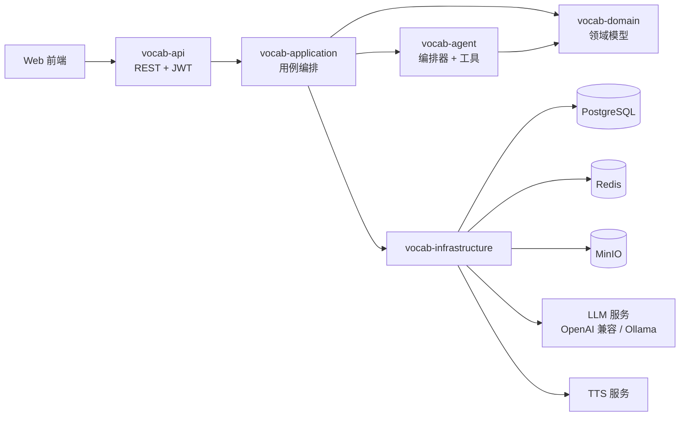
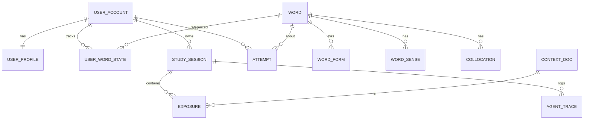
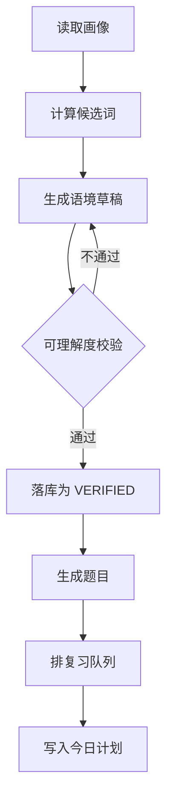
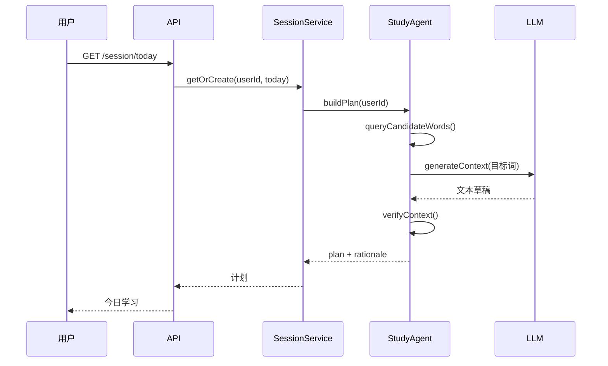
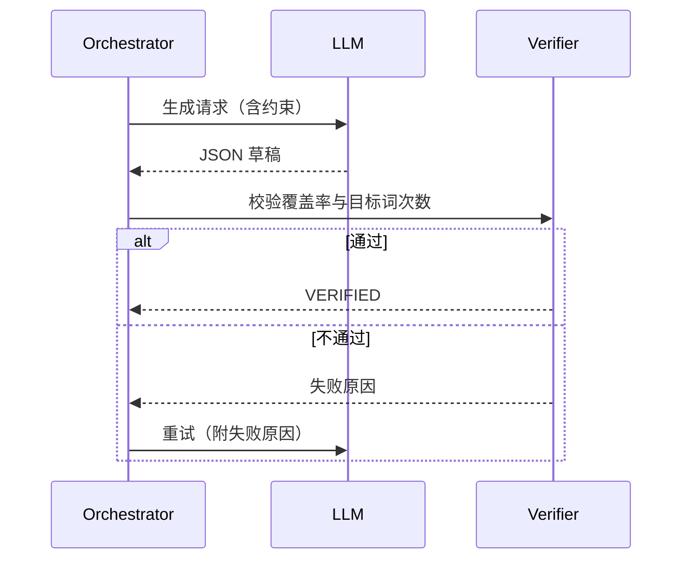

# 基于智能体的个性化语境式英语词汇学习平台 · 设计方案

| 项目 | 内容 |
|---|---|
| 文档版本 | v1.1 |
| 日期 | 2026-11-10 |
| 后端技术栈 | Java 21 LTS + Spring Boot 3.3+ |
| 前端技术栈 | Vue 3 + TypeScript + Vite + Pinia + Tailwind CSS |
| 数据存储 | PostgreSQL 16 + Redis 7 + MinIO |
| 前端形态 | 响应式 Web（后续可扩展小程序） |
| 设计依据 | NGSL 1.2 词表、《告诉你外语学习的真实方法与误区分析》、《找对英语学习方法的第一本书》、间隔重复算法长文两篇 |

---

## 1. 设计依据

### 1.1 资料盘点

| 资料 | 可用内容 | 在系统中的作用 |
|---|---|---|
| NGSL 1.2 词表 | 2809 个 NGSL 词元、47 个补充词（SUP）、955 个学术词（NAWL） | 选词与分级的底座 |
| `NGSL+with+SFI+(31K).xlsx` | 31,240 行，含 SFI 排名、SFI 值、每百万调整频次 U、分布均匀度 D、单词覆盖率、累计覆盖率 | 计算"先学谁" |
| `NGSL_1.2_with_English_definitions.xlsx` | 2809 条英文释义 | 释义兜底与英英解释 |
| `NGSL_1.2_lemmatized_for_teaching.csv` | 词元与词形对应 | 词族识别、文本词形还原 |
| 《告诉你外语学习的真实方法与误区分析》 | 常见误区清单、可理解输入、无效输入、4 秒声音缓存、发音取决于听辨 | 决定"怎么学" |
| 《找对英语学习方法的第一本书》 | 70%–80% 可懂度、20%–30% 生词、人造语言环境的可控重复、输入优先、成人习得周期 | 决定"语境难度与复现机制" |
| 《间隔重复记忆算法：e 天内，从入门到入土。》 | SM-0 / SM-2 / SM-4 经验算法，记忆三变量模型，稳定性增长 SInc，记忆复合性，DSR 模型与 SRS 模拟，SSP-MMC | 决定复习调度与卡片原子化 |
| 《KDD'22 \| 墨墨背单词：基于时序模型与最优控制的记忆算法》 | DHP 模型、2.2 亿条记忆行为数据、SSP-MMC 最优策略与离线模拟结果 | 决定调度算法的演进路线 |

### 1.2 NGSL 实测结论

按 `NGSL+with+SFI+(31K).xlsx` 的 `Coverage` 列累加，得到：

| 累计词数 | 文本覆盖率 |
|---|---|
| 500 | 74.3% |
| 1000 | 81.8% |
| 1500 | 85.8% |
| 2000 | 88.3% |
| 2500 | 90.0% |
| 2809 | 90.8% |

三条可直接用于产品的结论：

1. **覆盖率增长是强递减的**。前 1000 词买到 81.8%，后 1809 词只多买 9 个百分点。选词必须按"覆盖收益"排序，而不是按字母序或教材单元。
2. **频次高不等于该早学**。`unclear` 每百万出现 106 次，但 `D`（分布均匀度）仅 0.05，说明它高度集中在少数文本类型。D 值低于阈值的词需要降权。
3. **词表天然分层**。NGSL（通用）→ SUP（补充）→ NAWL（学术），可以直接映射为三条学习路径，不需要重新造分级体系。

### 1.3 方法论到系统机制的映射

| 资料观点 | 系统机制 |
|---|---|
| 听不懂的输入等于噪音 | 语境生成后必须做"已知词覆盖率"校验，不达标重写 |
| 材料听懂 70%–80% 最合适 | 听力材料按 75% 可懂度生成；阅读材料按 95% 已知词生成 |
| 真实环境里同一表达复现率极低 | 由系统强制同一目标词在多个语境、多个时间点复现 |
| 声音印象只保留约 4 秒 | 目标词在单篇内至少出现 2 次，且不连续；听力材料做 3 次间隔复现 |
| 输入是必要且充分条件，输出不是 | 主线是读/听后的再认与回忆，输出题只用于暴露漏洞 |
| 成人达到流利约为年龄 ÷ 6 年 | 学习目标按"可读文本比例"设定，不承诺短期流利 |
| 发音问题源于听辨 | 拼写与辨音题使用最小对立对，并提供多口音音频 |

### 1.4 资料缺口

以下内容资料区没有提供，必须在方案中补齐：

- 中文释义：NGSL 只有英文释义，需生成后人工抽检
- 例句与真实搭配：需引入语料库或由模型生成
- 音频：需 TTS 或外部发音库
- 义项拆分：NGSL 按词元组织，不区分多义项，需自建 `word_sense`
- 考试对齐（CET/IELTS/TOEFL）：需外部映射表
- 领域词表：NAWL 只有 955 个学术词，技术、商务等领域词需另行准备

### 1.5 间隔重复资料的关键结论

这两篇资料把"复习"从经验规则变成了可计算的模型，其中六条直接改变系统设计：

**1. 记忆状态是三个变量，不是一个"掌握度"。**

- 记忆稳定性 `S`：回忆概率从 100% 降到 90% 所需的时间（部分文献用半衰期，即降到 50%）
- 记忆可提取性 `R`：某一时刻的回忆概率
- 记忆难度 `D`：材料内在难度

遗忘曲线近似指数函数：

```
R(t) = exp(-t / S)
```

**2. 稳定性增长有三条已被数据验证的规律。**

- `S` 越大，稳定性增长 `SInc` 越小（负幂关系）：越熟的词越难再提升
- `R` 越低，成功后 `SInc` 越大（指数关系）：这就是间隔效应
- `D` 越大，`SInc` 越小：难词需要更多次复习

资料特别指出：当 `R = 100%` 时，`SInc` 可能低于 1，即"刚看完就重复"不仅浪费时间，还可能损害记忆。

**3. 复合记忆的稳定性低于任一子记忆。**

复合记忆的可提取性是子记忆可提取性之积，稳定性会被拉到较难的那个子记忆的水平。直接推论：**一个单词不能做成一张"词义 + 拼写 + 搭配"的复合卡**，必须拆成原子卡。这为 5.3 中四个独立掌握度字段提供了理论依据，而不是产品偏好。

**4. 经验算法的演进给出了参数先验。**

| 算法 | 机制 | 可借用之处 |
|---|---|---|
| SM-0 | 间隔 1 / 7 / 16 / 35 天，之后 ×2 | 初始间隔先验 |
| SM-2 | 引入简易度 EF（初值 2.5）与回忆评分 q | 失败后重置、成功则拉长 |
| SM-4 | 最优间隔矩阵，跨卡片共享调整经验 | 参数应随用户群体更新 |
| SM-17 | 稳定性增长 SInc 的命名与分解 | 状态转移方程的写法 |

**5. 调度可以写成"随机最短路径"。**

SSP-MMC 把每张卡的复习看作马尔可夫决策过程：状态是 `(S, D)`，动作是"下次间隔"，成本是复习耗时，目标是"在成本约束下让尽可能多的材料达到目标稳定性"。

资料给出的离线模拟参数与结果：

- 目标半衰期 360 天，模拟 1000 天，每日成本上限 600 秒
- 成功回忆计 3 秒，失败计 9 秒
- 达到 6000 个目标词：SSP-MMC 用 466 天，Anki 用 569 天，THRESHOLD 用 533 天
- 相对 THRESHOLD 节省约 12.6% 的复习时间

**6. 复习目标不该是"清空队列"。**

资料指出最大期望稳定性增长出现在 `R ≈ 30%–40%`，但这不等于最高学习效率；真正的最优解是在时间预算内最大化长期留存。因此产品的复习指标应定义为"在每日时长约束下，目标稳定性达成量"，而不是"今日待复习数归零"。

对本方案的净影响：

- 6.4 从"自造间隔公式"改为 DSR 体系，并按 P0/P1/P2 分阶段落地
- 5.3 的四维拆分从"设计选择"升级为"算法要求"
- 前端"复习"页必须展示 `S` 与 `R`，让用户理解"为什么现在复习它"

---

## 2. 产品定义

### 2.1 一句话定位

不是"背单词 App"，而是**一个能保证输入可理解、复现可控制的个人词汇输入系统**。

### 2.2 目标用户

| 类型 | 特征 | 默认路径 |
|---|---|---|
| 备考型 | 有明确考试目标，时间紧 | 考试词表优先，覆盖率按考试文本校准 |
| 阅读型 | 想读英文文档、论文、新闻 | 领域词表优先，语境取真实文本风格 |
| 兴趣型 | 想看懂剧、小说、游戏 | 兴趣主题优先，语境偏叙事与对话 |
| 恢复型 | 学过多年但长期不用 | 先做测词，重排在"半生不熟"区间 |

非目标用户：零基础儿童、需要系统语法课程的学习者、以口语陪练为核心诉求的用户。

### 2.3 核心假设

1. 学习者愿意每天投入 15–25 分钟，但不愿做无上下文的词表打卡。
2. "今天该学什么"由系统算出来，比用户自己挑更有效。
3. 语境只要足够可理解，重复密度足够，词汇留存会显著优于列表记忆。
4. 用户能感知到"智能体在替我编排"，并因此更愿意坚持。

### 2.4 成功指标

| 层级 | 指标 | 目标 |
|---|---|---|
| 北极星 | 周留存 ≥ 4 天 | ≥ 35% |
| 学习效果 | 30 天后同词再认正确率 | ≥ 80% |
| 学习效果 | 目标文本未知词比例下降 | 相对下降 ≥ 15% |
| 体验 | 语境"读得下去"评分 | ≥ 4.0 / 5 |
| 系统 | 今日会话首屏 P95 | ≤ 300 ms |
| 系统 | 语境生成成功率（含重试） | ≥ 98% |

---

## 3. 设计原则

| # | 原则 | 资料依据 | 系统落点 |
|---|---|---|---|
| P1 | 按覆盖收益选词 | 覆盖率强递减 | `SelectionService` 评分函数 |
| P2 | 语境必须可理解 | 无效输入理论 | `ComprehensibilityVerifier` |
| P3 | 重复由系统制造 | 真实复现率低、4 秒缓存 | 目标词多次跨语境复现 |
| P4 | 输入优先，输出检验 | 输入必要且充分 | 题型权重与主流程顺序 |
| P5 | 成人路径不照搬儿童 | 成人习得周期 | 目标设定与文案口径 |
| P6 | 卡片必须原子化 | 复合记忆稳定性低于子记忆 | 四维拆分、题型分离 |

补充约束：

- **不做**统一遗忘曲线。复习间隔由 DSR 状态与目标留存率计算（见 6.4）。
- **不做**"背完即复习"。`R = 100%` 时稳定性增长可能小于 1，刚学完立刻重复是负收益。
- **不做**"每日一词"式内容流。每天的词必须来自同一份学习计划。
- **不做**纯词根词缀拆解作为主要记忆手段。词源只作为辅助锚点，不进入评分。

---

## 4. 总体架构

### 4.1 技术选型

| 层次 | 选型 | 说明 |
|---|---|---|
| 语言 | Java 21 LTS | 虚拟线程处理 LLM 长调用 |
| 框架 | Spring Boot 3.3+ | Web、Validation、Actuator |
| 持久层 | Spring Data JPA + `JdbcClient` | JPA 管实体，复杂统计走原生 SQL |
| 数据库 | PostgreSQL 16 | JSONB 存计划与轨迹，窗口函数做统计 |
| 缓存 | Redis 7 + Caffeine | 词典本地缓存，用户已知词位图放 Redis |
| 消息/异步 | Spring `@Async` + 虚拟线程 | MVP 不引入 MQ，后续可换 RabbitMQ |
| 对象存储 | MinIO | 音频与生成文本快照 |
| 鉴权 | Spring Security + JWT | 无状态，支持后续小程序 |
| LLM | Spring AI（OpenAI 兼容协议） | 可切换本地 Ollama 降级 |
| 文档 | springdoc-openapi | 自动生成 OpenAPI 3 |
| 迁移 | Flyway | 表结构与词库导入脚本版本化 |
| 可观测 | Micrometer + Prometheus + Grafana | 关键链路埋点 |
| 测试 | JUnit 5 + Testcontainers + k6 | 单测、集成、压测 |
| 构建 | Maven 多模块 | 按领域拆分 |

选择理由：

- 选 PostgreSQL 而非 MySQL：JSONB（学习计划、智能体轨迹）、数组（领域标签）、窗口函数（覆盖率统计）都更顺手。
- 选 JPA 而非 MyBatis：领域模型稳定，CRUD 占多数；统计查询用 `JdbcClient` 直接写 SQL，避免引入两套映射。
- 不引入 Spring Batch：词库只导入一次，`ApplicationRunner` + POI 足够；避免为一次性任务增加复杂度。

### 4.2 模块划分

```
english-vocab-server
├── vocab-common          通用返回体、异常、工具、枚举
├── vocab-domain          实体、值对象、领域服务接口
├── vocab-infrastructure  持久化、Redis、LLM 客户端、TTS、对象存储
├── vocab-application     用例编排、事务边界
├── vocab-agent           智能体编排器、工具定义、提示词
├── vocab-api             REST 控制器、鉴权、参数校验
└── vocab-bootstrap       启动类、配置、Flyway、数据导入
```

依赖方向：`api → application → domain ← infrastructure`，`agent → application`。禁止 `api` 直接依赖 `infrastructure`。

### 4.3 运行时架构



### 4.4 代码目录

```
src/main/java/com/wordscape
├── common
│   ├── ApiResponse.java
│   ├── BizException.java
│   ├── ErrorCode.java
│   └── TraceContext.java
├── domain
│   ├── word/ Word.java WordForm.java WordSense.java Collocation.java
│   ├── learner/ UserAccount.java UserProfile.java UserWordState.java
│   ├── study/ StudySession.java Exposure.java Attempt.java
│   └── context/ ContextDoc.java
├── application
│   ├── PlacementService.java
│   ├── SelectionService.java
│   ├── ContextService.java
│   ├── DrillService.java
│   ├── ReviewService.java
│   └── ReportService.java
├── agent
│   ├── StudyAgentOrchestrator.java
│   ├── tool/ (WordQueryTool, ContextTool, DrillTool, ReviewTool)
│   ├── prompt/ PromptTemplates.java
│   └── AgentTraceService.java
├── infrastructure
│   ├── persistence/ (JPA Repository, JdbcQuery)
│   ├── cache/ KnownWordBitmapCache.java
│   ├── llm/ LlmClient.java
│   ├── tts/ TtsClient.java
│   └── storage/ ObjectStorageClient.java
└── api
    ├── AuthController.java
    ├── ProfileController.java
    ├── PlacementController.java
    ├── SessionController.java
    ├── ContextController.java
    ├── ReviewController.java
    ├── ReportController.java
    └── AgentTraceController.java
```

---

## 5. 领域模型

### 5.1 核心实体

| 实体 | 说明 | 关键字段 |
|---|---|---|
| `Word` | 词元 | lemma、wordlist、sfiRank、u、dispersion、coverage、中英释义 |
| `WordForm` | 词形 | form、formType（复数/过去式/派生） |
| `WordSense` | 义项 | pos、释义、例句、义项顺序 |
| `Collocation` | 搭配 | pattern、example、频次 |
| `UserAccount` | 账号 | email、passwordHash |
| `UserProfile` | 学习画像 | goal、domain、dailyMinutes、interests、targetExam |
| `UserWordState` | 词 × 维度的原子记忆状态，一个词四行 | dimension、mastery、stability(S)、difficulty(D)、nextDueAt |
| `ContextDoc` | 语境文本 | theme、body、wordCount、knownRatio、targetWordIds、status |
| `StudySession` | 每日会话 | sessionDate、planJson、status |
| `Exposure` | 曝光记录 | wordId、contextId、modality、position |
| `Attempt` | 作答记录 | wordId、itemType、isCorrect、errorType、responseMs |
| `AgentTrace` | 智能体轨迹 | step、rationale、toolName、latency、tokens |

### 5.2 ER 图



### 5.3 表设计

```sql
-- 词库
CREATE TABLE word (
    id                  BIGSERIAL PRIMARY KEY,
    lemma               VARCHAR(64)  NOT NULL UNIQUE,
    wordlist            VARCHAR(16),              -- NGSL / SUP / NAWL / EXT
    sfi_rank            INTEGER,
    sfi                 NUMERIC(6,2),
    u_per_million       NUMERIC(10,3),
    dispersion          NUMERIC(4,3),
    coverage            NUMERIC(8,6),
    cumulative_coverage NUMERIC(8,6),
    phonetic_uk         VARCHAR(64),
    phonetic_us         VARCHAR(64),
    audio_url           VARCHAR(255),
    cefr                VARCHAR(4),
    definition_en       TEXT,
    definition_zh       TEXT,
    domain_tags         TEXT[],
    created_at          TIMESTAMPTZ NOT NULL DEFAULT now()
);
CREATE INDEX idx_word_rank ON word (wordlist, sfi_rank);
CREATE INDEX idx_word_u ON word (u_per_million DESC);

CREATE TABLE word_form (
    id         BIGSERIAL PRIMARY KEY,
    word_id    BIGINT NOT NULL REFERENCES word(id),
    form       VARCHAR(64) NOT NULL,
    form_type  VARCHAR(16) NOT NULL,
    UNIQUE (word_id, form)
);
CREATE INDEX idx_form ON word_form (form);

CREATE TABLE word_sense (
    id            BIGSERIAL PRIMARY KEY,
    word_id       BIGINT NOT NULL REFERENCES word(id),
    pos           VARCHAR(16),
    definition_zh TEXT,
    definition_en TEXT,
    example       TEXT,
    sense_order   SMALLINT NOT NULL DEFAULT 1
);

CREATE TABLE collocation (
    id        BIGSERIAL PRIMARY KEY,
    word_id   BIGINT NOT NULL REFERENCES word(id),
    pattern   VARCHAR(128) NOT NULL,
    example   TEXT,
    frequency INTEGER DEFAULT 0
);

-- 学习者
CREATE TABLE user_account (
    id            BIGSERIAL PRIMARY KEY,
    email         VARCHAR(128) NOT NULL UNIQUE,
    password_hash VARCHAR(100) NOT NULL,
    nickname      VARCHAR(64),
    created_at    TIMESTAMPTZ NOT NULL DEFAULT now()
);

CREATE TABLE user_profile (
    user_id        BIGINT PRIMARY KEY REFERENCES user_account(id),
    goal           VARCHAR(16)  NOT NULL,   -- EXAM / READING / INTEREST / RECOVERY
    domain         VARCHAR(64),
    target_exam    VARCHAR(16),
    daily_minutes  SMALLINT NOT NULL DEFAULT 20,
    interests      JSONB NOT NULL DEFAULT '[]',
    known_estimate INTEGER NOT NULL DEFAULT 0,
    known_ci_low   INTEGER,
    known_ci_high  INTEGER,
    updated_at     TIMESTAMPTZ NOT NULL DEFAULT now()
);

-- 每个"词 × 维度"一行，对应一张原子记忆卡（见 6.4.2）
CREATE TABLE user_word_state (
    user_id         BIGINT NOT NULL REFERENCES user_account(id),
    word_id         BIGINT NOT NULL REFERENCES word(id),
    dimension       VARCHAR(16) NOT NULL,          -- RECOGNITION / RECALL / SPELLING / COLLOCATION
    mastery         SMALLINT NOT NULL DEFAULT 0,   -- 0-100，用于展示与选词
    stability       REAL     NOT NULL DEFAULT 0,   -- S，天
    difficulty      REAL     NOT NULL DEFAULT 0.3, -- D，0-1
    exposures       INTEGER  NOT NULL DEFAULT 0,
    lapses          INTEGER  NOT NULL DEFAULT 0,
    first_seen_at   TIMESTAMPTZ,
    last_seen_at    TIMESTAMPTZ,
    next_due_at     TIMESTAMPTZ,
    PRIMARY KEY (user_id, word_id, dimension)
);
CREATE INDEX idx_due ON user_word_state (user_id, next_due_at);

-- 学习过程
CREATE TABLE context_doc (
    id              BIGSERIAL PRIMARY KEY,
    theme           VARCHAR(32) NOT NULL,
    difficulty      VARCHAR(16) NOT NULL,     -- A2 / B1 / B2 / C1
    body            TEXT NOT NULL,
    word_count      INTEGER NOT NULL,
    known_ratio     NUMERIC(5,4) NOT NULL,
    target_word_ids BIGINT[] NOT NULL,
    source          VARCHAR(16) NOT NULL,     -- AGENT / TEMPLATE / HUMAN
    model_name      VARCHAR(64),
    prompt_version  VARCHAR(16),
    status          VARCHAR(16) NOT NULL,     -- DRAFT / VERIFIED / REJECTED
    created_at      TIMESTAMPTZ NOT NULL DEFAULT now()
);

CREATE TABLE study_session (
    id           BIGSERIAL PRIMARY KEY,
    user_id      BIGINT NOT NULL REFERENCES user_account(id),
    session_date DATE NOT NULL,
    plan_json    JSONB NOT NULL,
    status       VARCHAR(16) NOT NULL DEFAULT 'PLANNED',
    created_at   TIMESTAMPTZ NOT NULL DEFAULT now(),
    UNIQUE (user_id, session_date)
);

CREATE TABLE exposure (
    id          BIGSERIAL PRIMARY KEY,
    session_id  BIGINT NOT NULL REFERENCES study_session(id),
    user_id     BIGINT NOT NULL,
    word_id     BIGINT NOT NULL REFERENCES word(id),
    context_id  BIGINT REFERENCES context_doc(id),
    modality    VARCHAR(8) NOT NULL,          -- READ / LISTEN
    position    INTEGER,
    created_at  TIMESTAMPTZ NOT NULL DEFAULT now()
);
CREATE INDEX idx_exposure_user_word ON exposure (user_id, word_id, created_at DESC);

CREATE TABLE attempt (
    id          BIGSERIAL PRIMARY KEY,
    client_id   VARCHAR(64) NOT NULL UNIQUE,  -- 幂等键
    user_id     BIGINT NOT NULL,
    word_id     BIGINT NOT NULL REFERENCES word(id),
    item_type   VARCHAR(24) NOT NULL,
    is_correct  BOOLEAN NOT NULL,
    error_type  VARCHAR(24),
    response_ms INTEGER,
    created_at  TIMESTAMPTZ NOT NULL DEFAULT now()
);

CREATE TABLE agent_trace (
    id          BIGSERIAL PRIMARY KEY,
    session_id  BIGINT NOT NULL REFERENCES study_session(id),
    step        VARCHAR(32) NOT NULL,
    tool_name   VARCHAR(64),
    rationale   TEXT,
    payload     JSONB,
    latency_ms  INTEGER,
    token_in    INTEGER,
    token_out   INTEGER,
    created_at  TIMESTAMPTZ NOT NULL DEFAULT now()
);

CREATE TABLE daily_metric (
    user_id          BIGINT NOT NULL,
    metric_date      DATE NOT NULL,
    new_words        INTEGER NOT NULL DEFAULT 0,
    reviews          INTEGER NOT NULL DEFAULT 0,
    accuracy         NUMERIC(5,4),
    known_estimate   INTEGER,
    coverage_ratio   NUMERIC(5,4),
    PRIMARY KEY (user_id, metric_date)
);
```

### 5.4 词库导入

- 读取 `NGSL+with+SFI+(31K).xlsx` 的 `SFI adj` 工作表，按 `WL_SFI_Rank` 排序写入 `word`
- `Wordlist` 为空的词记为 `EXT`，只作为候选词，不进入默认学习路径
- 读取 `NGSL_1.2_with_English_definitions.xlsx` 回填 `definition_en`
- 读取 `NGSL_1.2_lemmatized_for_teaching.csv` 写入 `word_form`
- 导入任务用 `ApplicationRunner` + 幂等 upsert（`ON CONFLICT (lemma) DO UPDATE`），可重复执行
- 中文释义、音标、音频通过离线批处理补充，缺失时前端降级显示英文释义

---

## 6. 核心算法

### 6.1 已知词量估计

**目标**：在不做 2809 题的前提下，估计用户已掌握的词量与覆盖曲线。

**流程**：

1. 从 NGSL 按 SFI 排名分 10 层，每层抽 4 词，共 40 题（含 4 个伪词用于检测乱答）。
2. 每题给出词 + 四个中文释义选项。
3. 每层正确率 `p_i` 作为该层的掌握比例。
4. 用一参数 Logistic（Rasch）拟合曲线：

```
P(known | rank) = 1 / (1 + exp((rank - θ) / s))
```

- `θ`：用户水平参数，用最大似然估计
- `s`：斜率，初始取 600，后续用全体用户数据回归

5. 已知词量：

```
known = Σ_{rank=1..2809} P(known | rank)
```

6. 覆盖率：把 `P(known)` 与每个词的 `coverage` 相乘后累加。
7. 置信区间：对 40 题做 1000 次 bootstrap，取 2.5% 与 97.5% 分位。

**冷启动兜底**：用户跳过测试时，按目标与自评水平给初始 `θ`，之后用答题结果持续校正。

### 6.2 选词

**候选池**：

- 该用户 `user_word_state` 中不存在的 NGSL 词
- 目标领域差集词（NAWL 或领域词表，且不在已知集合）
- 排除 `dispersion < 0.3` 且与用户目标无关的词

**评分函数**：

```
score(w) = log(1 + U_w)
         × D_w^0.5
         × goalWeight(w)
         × (1 - mastery(w))
         × freshness(w)
         × typeBalance(w)
```

| 因子 | 计算 |
|---|---|
| `U_w` | 每百万频次，做对数压缩，避免 the/be 类词垄断 |
| `D_w` | 分布均匀度，开方后使用，惩罚单一领域高频词 |
| `goalWeight` | 目标相关词 ×3，通用词 ×1，无关领域词 ×0.5 |
| `mastery` | 四维掌握度加权平均：再认 0.4、回忆 0.3、拼写 0.2、搭配 0.1 |
| `freshness` | `exp(-近 7 天曝光次数 / 3)`，防止反复推同一批词 |
| `typeBalance` | 同一词性、同一语义簇超过 2 个时降权 |

**硬约束**：

- 每日新词 6–10 个，按 `dailyMinutes` 调整
- 同一语义簇最多 2 个
- 新词难度只取用户当前水平上一层（i+1）
- 复习词优先于新词，复习未完成时新词最多 5 个

**输出**：按分数降序取 N 个，同时返回每个词的入选理由，供智能体解释。

### 6.3 语境生成与校验

**输入**：目标词集合、用户兴趣、已知词集合、难度、篇幅、模态。

**生成约束**（写入提示词）：

- 目标词 6–10 个，每个至少出现 2 次
- 已知词覆盖率 ≥ 95%（阅读）/ 可懂度 ≥ 75%（听力）
- 平均句长 ≤ 22 词
- 不出现未列入目标词的低频词
- 文体由兴趣决定：科幻、职场、旅行、体育等

**校验器**（`ComprehensibilityVerifier`）：

```
1. 分词 → 词形还原 → 映射到 word_id
2. 过滤专有名词、数字、标点
3. knownRatio = 已知词数 / 实词总数
4. 校验每个目标词出现次数 ≥ 2
5. 校验平均句长、生词密度、禁用词
6. 任一项不通过 → 返回具体原因，重试
```

**重试策略**：

- 最多重试 3 次
- 第 2 次起把失败原因追加进提示词
- 3 次仍失败 → 降级为模板语境（从预置语料里选最接近的），并标记 `source=TEMPLATE`
- 所有生成结果存 `context_doc`，通过校验才置 `VERIFIED`

### 6.4 复习调度

**理论基座**：DSR 三变量模型。每个"词 × 维度"是一个原子记忆对象，独立维护 `S`、`D`、`R`。

#### 6.4.1 状态定义

| 变量 | 含义 | 单位 |
|---|---|---|
| `S` | 记忆稳定性，回忆概率从 100% 降到 90% 所需时间 | 天 |
| `D` | 记忆难度，0–1，越大越难 | 无量纲 |
| `R` | 可提取性，当前回忆概率 | 0–1 |

```
R(t) = exp(-t / S)
```

`t` 为距上次成功复习的天数。`R` 不落库，按需计算；`S`、`D` 落库。

#### 6.4.2 原子化

资料结论：复合记忆的可提取性是子记忆之积，稳定性会被拉到较难的子记忆水平。因此一个单词拆成四张原子卡：

| 原子卡 | 题型 | 初始 S | 目标 R | S 上限（天） |
|---|---|---|---|---|
| 再认 | 见词选义 | 1.0 | 0.90 | 180 |
| 回忆 | 中文想词 | 0.8 | 0.88 | 180 |
| 拼写 | 听音拼写 | 0.4 | 0.85 | 90 |
| 搭配 | 语境填空 | 0.6 | 0.85 | 120 |

同一单词的四种卡不同时出现，避免又把复合记忆拼回去。

#### 6.4.3 状态转移

P0 采用 DSR 的工程化简化式，参数先验来自 SM-2 / SM-4，上线后用真实日志拟合：

成功（`result = 1`）：

```
S' = S × (1 + a × (1 - R) × (11 - D) / 10 × S^(-b))
```

失败（`result = 0`）：

```
S' = max(0.5, c × S × D^(-d))
D' = min(1, D + e)
```

先验参数：

| 参数 | 初值 | 含义 |
|---|---|---|
| `a` | 1.2 | 成功增益系数 |
| `b` | 0.2 | 稳定性的边际递减 |
| `c` | 0.35 | 失败后的稳定性保留比例 |
| `d` | 0.5 | 难度对失败的放大 |
| `e` | 0.05 | 每次失败增加的难度 |

性质校验（必须由单测覆盖）：

- `R → 0` 时 `S'` 更大，符合间隔效应
- `R → 1` 时 `S' → S`，不出现"刚复习就暴涨"
- `D → 1` 时 `S'` 更小，难词增益低
- 失败后 `S' < S`，且不低于 0.5 天

#### 6.4.4 间隔计算

```
interval = -S' × ln(targetR)
next_due = now + clamp(interval, 1, S上限) 天
```

例：再认卡 `S' = 6.2`，`targetR = 0.90`，间隔为 `-6.2 × ln(0.9) ≈ 0.65` 天，向上取 1 天；`S' = 60` 时约 6.3 天。

#### 6.4.5 每日队列

排序依据是"单位时间收益"，而不是逾期天数：

```
benefit = (1 - R_now) × gapWeight × goalWeight
cost    = R_now × 3s + (1 - R_now) × 9s     // 资料中的成功/失败成本假设
priority = benefit / cost
```

- 队列上限由 `dailyMinutes` 换算，默认 20–30 张卡
- 同一单词最多出现两张不同维度的卡
- 连续成功且 `S > 30` 的卡降级为抽查，不再进入每日队列

#### 6.4.6 三阶段演进

| 阶段 | 方案 | 说明 |
|---|---|---|
| P0 | DSR-lite | 上述公式 + 先验参数，跑通闭环 |
| P1 | 参数拟合 | 用答题日志按用户分层拟合 `a/b/c/d/e`，冷启动用群体参数 |
| P2 | SSP-MMC 策略表 | 离线值迭代求 `(S, D) → 最优间隔`，线上查表；目标稳定性 360 天 |

P2 的做法：把 `S` 按 `log` 分箱离散化，`D` 分 10 档，动作空间取 20 个候选间隔，用贝尔曼方程迭代至策略收敛；每次成本按成功 3 秒、失败 9 秒计。策略表随参数版本发布，不要求线上实时求解。

### 6.5 漏洞归因

错误类型枚举：

| 类型 | 判定方式 | 后续题型 |
|---|---|---|
| `MEANING` | 释义选错，且非形近干扰 | 语境再认 |
| `SPELLING` | 拼写编辑距离 ≤ 2 | 听音拼写 |
| `COLLOCATION` | 搭配填空错 | 短语填空、改错 |
| `SYNTAX` | 句子结构理解错 | 长句拆解 |
| `LOOKALIKE` | 与形近词混淆 | 最小对立对辨析 |
| `SPECIAL_SENSE` | 熟词僻义 | 多义项对照 |

归因后写入 `attempt.error_type`，同时提高对应维度的复习权重。

---

## 7. 智能体设计

### 7.1 职责边界

智能体**只做编排与解释**，不做以下事情：

- 不直接改数据库，所有写操作走应用服务
- 不自由生成词表，候选词必须来自 `SelectionService`
- 不跳过校验，生成的语境必须过 `ComprehensibilityVerifier`

### 7.2 工具清单

| 工具 | 入参 | 出参 | 用途 |
|---|---|---|---|
| `getLearnerProfile` | userId | 目标、兴趣、已知词量 | 编排上下文 |
| `estimateKnownWords` | userId | 估计值与区间 | 冷启动 |
| `queryCandidateWords` | userId, limit | 候选词及评分 | 选词 |
| `getWordDetail` | lemma | 释义、词形、搭配 | 生成语境 |
| `generateContext` | 目标词、主题、难度 | 文本草稿 | 生成 |
| `verifyContext` | 文本、目标词 | 覆盖率、问题列表 | 校验 |
| `buildDrillItems` | 词、漏洞类型、数量 | 题目列表 | 出题 |
| `scheduleReviews` | userId, 日期 | 复习队列 | 调度 |
| `composeReport` | userId, 日期 | 指标与解读 | 报告 |

工具用 Spring AI 的 `@Tool` 注解声明，参数用 record + `@JsonPropertyDescription`。

### 7.3 编排流程



每一步都写 `agent_trace`，包括 `rationale`。

### 7.4 提示词与结构化输出

系统提示词骨架：

```
你是英语词汇学习编排器。
约束：
1. 只能使用给定目标词，不得引入其他低频词。
2. 目标词每个至少出现 2 次，间隔不少于 1 句。
3. 句子平均长度不超过 22 词。
4. 不使用超出 B2 的语法结构。
5. 输出必须是 JSON，不要解释。
```

用户消息包含：目标词及释义、用户兴趣、难度、篇幅、上一次失败原因（重试时）。

输出 Schema：

```json
{
  "title": "string",
  "body": "string",
  "targetWords": ["string"],
  "sentences": 12,
  "estimatedDifficulty": "B1"
}
```

用 Spring AI 的 `BeanOutputConverter` 直接反序列化为 record，反序列化失败按生成失败处理。

### 7.5 可解释性

每个学习计划返回 `rationale` 列表，例如：

```
今天选了 8 个词：
- 6 个来自你目标文档中的高频未知词（合计覆盖 3.2%）
- 2 个是你上周答错 2 次以上的词
- 语境已知词占比 95.4%，符合可理解输入阈值
- 3 个拼写薄弱词被安排在明早复习
```

前端在"今日学习"页用可展开的决策条展示。

### 7.6 降级与成本

- **缓存**：以 `hash(目标词集合 + 主题 + 难度)` 为键缓存语境，命中率目标 ≥ 40%
- **批量预生成**：每天凌晨为活跃用户预生成次日语境
- **超时与熔断**：LLM 超时 20s，重试 2 次，Resilience4j 熔断
- **降级链**：LLM → 模板语境 → 预置语料
- **成本控制**：单用户单日 token 上限，超限后只走模板

---

## 8. 接口设计

### 8.1 约定

- 基础路径：`/api/v1`
- 鉴权：`Authorization: Bearer <jwt>`
- 统一返回：

```json
{
  "code": 0,
  "message": "ok",
  "data": {},
  "traceId": "b1f2c3"
}
```

- 幂等：写接口接受 `clientId`，重复提交返回首次结果
- 分页：`page`、`size`，默认 20

### 8.2 接口清单

| 方法 | 路径 | 说明 |
|---|---|---|
| POST | `/auth/register` | 注册 |
| POST | `/auth/login` | 登录 |
| GET | `/me/profile` | 学习画像 |
| PUT | `/me/profile` | 更新目标、兴趣、每日时长 |
| POST | `/placement/start` | 开始测词 |
| POST | `/placement/answer` | 提交单题 |
| GET | `/placement/result` | 测词结果与覆盖曲线 |
| GET | `/session/today` | 今日计划（含 rationale） |
| POST | `/session/{id}/start` | 开始会话 |
| GET | `/contexts/{id}` | 获取语境文本 |
| POST | `/contexts/{id}/read` | 标记已读，写入 exposure |
| POST | `/attempts` | 提交作答 |
| GET | `/reviews/today` | 今日复习队列 |
| POST | `/reviews/{wordId}` | 提交复习结果 |
| GET | `/reports/daily` | 日报 |
| GET | `/reports/overview` | 覆盖率与趋势 |
| GET | `/gaps/summary` | 六类漏洞矩阵与修复收益排序 |
| GET | `/contexts` | 语境库列表（主题、难度、篇幅筛选） |
| GET | `/agent/traces/{sessionId}` | 智能体决策轨迹 |
| GET | `/words/{lemma}` | 词条详情 |

### 8.3 示例

`GET /api/v1/session/today`

```json
{
  "code": 0,
  "message": "ok",
  "data": {
    "sessionId": 1024,
    "date": "2026-11-09",
    "estimatedMinutes": 21,
    "newWords": [
      {"lemma": "conduct", "sfiRank": 412, "reason": "目标文档高频未知词"},
      {"lemma": "approach", "sfiRank": 389, "reason": "上周答错 2 次"}
    ],
    "context": {
      "id": 8801,
      "theme": "scifi",
      "wordCount": 198,
      "knownRatio": 0.954,
      "targetCount": 8
    },
    "reviewCount": 18,
    "rationale": [
      "今日新词全部来自你的目标文档差集",
      "语境已知词占比 95.4%，高于 95% 阈值",
      "3 个拼写薄弱词已安排在明早复习"
    ]
  },
  "traceId": "b1f2c3"
}
```

`POST /api/v1/attempts`

```json
{
  "clientId": "6e2f0c1a-...",
  "wordId": 412,
  "itemType": "MEANING_CHOICE",
  "isCorrect": false,
  "errorType": "LOOKALIKE",
  "responseMs": 4300
}
```

---

## 9. 关键流程时序

### 9.1 每日会话



### 9.2 语境生成与校验



---

## 10. 前端设计

> 本版重新设计，不再沿用原型的六页平铺结构。

### 10.1 设计目标

| # | 目标 | 判定标准 |
|---|---|---|
| D1 | 阅读器优先 | 首屏 60% 面积是文本，不是卡片墙 |
| D2 | 输入在前 | 阅读未完成时，训练入口不可点击 |
| D3 | 可解释 | 每个"智能"结论都能展开到参数与依据 |
| D4 | 安静 | 无渐变、无插画、无徽章墙，单屏一个主按钮 |
| D5 | 可恢复 | 任何中断后回来，进度不丢 |

产品气质：纸张、墨、深绿。参照阅读器与工作台，而不是游戏化学习 App 的热闹。

### 10.2 技术选型

| 层次 | 选型 | 理由 |
|---|---|---|
| 框架 | Vue 3.4 + TypeScript | 组合式 API 适合阅读器这类状态密集页面 |
| 构建 | Vite 5 | 冷启动快，按路由分包 |
| 状态 | Pinia | 五个 store 边界清晰 |
| 路由 | Vue Router 4 | 阅读器需要可回退的 URL |
| 样式 | Tailwind CSS 3 + CSS 变量 | token 与暗色模式统一由变量驱动 |
| 图表 | ECharts 5 | 覆盖率曲线、日历热力图 |
| 请求 | Axios + 拦截器 | 统一 traceId、401 刷新 |
| 工具 | VueUse | 键盘、滚动、媒体查询 |
| 测试 | Vitest + Playwright | 单测组件，端到端跑通学习闭环 |

不引入组件库。现有组件库的默认视觉（大圆角、彩色徽章、阴影卡片）与 D4 冲突，自建 12 个组件成本更低。

### 10.3 信息架构

原型的问题：六个一级入口里，"今日学习"和"语境学习"内容重叠，"专项训练"没有独立价值，用户每次都要先判断"我现在该点哪个"。

重构后：

```
词境
├── 今天      学习台：读 → 练 → 复习，一条任务链
├── 阅读      语境库 + 沉浸阅读器
├── 漏洞      诊断矩阵与修复清单
├── 复习      卡片流
├── 报告      覆盖率与长期趋势
└── 设置      画像、目标、节奏、账号
```

变化说明：

- **专项训练降级**：并入"今天"的第二段，不再占一级入口
- **语境学习拆分**：库在"阅读"，当下要读的那篇在"今天"
- **漏洞图谱改名"漏洞"**：不再用"图谱"这种需要解释的隐喻

### 10.4 设计语言

#### 10.4.1 色彩 token

| Token | Light | Dark | 用途 |
|---|---|---|---|
| `--bg` | `#FBFAF7` | `#121311` | 页面底色 |
| `--surface` | `#FFFFFF` | `#1A1B18` | 卡片与抽屉 |
| `--text` | `#1A1A18` | `#ECECE6` | 正文 |
| `--text-muted` | `#6B6B66` | `#A3A39C` | 次要信息、参数 |
| `--line` | `#E6E3DC` | `#2C2D29` | 分隔线、边框 |
| `--accent` | `#1F6F4A` | `#5FD39A` | 主操作、目标词 |
| `--accent-soft` | `#E7F1EB` | `#123326` | 选中态、词高亮底 |
| `--warn` | `#B4690E` | `#E0A458` | 逾期、生成失败 |
| `--danger` | `#B4342A` | `#EF7A70` | 答错 |

规则：主色只用于"可操作"和"目标词"，不用于装饰。语义色只出现在状态场景。

#### 10.4.2 字体与排版

| 场景 | 字体 | 字号 / 行高 |
|---|---|---|
| 阅读正文 | Noto Serif SC / Source Serif 4 | 19px / 1.9，行宽 ≤ 680px |
| UI 正文 | Inter / PingFang SC | 14px / 20px |
| 页面标题 | 同上 | 28px / 36px |
| 区块标题 | 同上 | 20px / 28px |
| 参数与数字 | 同上，`tabular-nums` | 12px / 18px、13px / 20px |

阅读正文使用衬线体是刻意的：它与"背单词 App"的观感拉开距离，也更接近真实阅读材料。

#### 10.4.3 间距、圆角、动效

- 间距：4 / 8 / 12 / 16 / 24 / 32 / 48
- 圆角：控件 8，卡片 16，抽屉 24（仅顶部两角）
- 阴影：只用于抽屉与弹层，`0 8px 24px rgba(0,0,0,.08)`
- 动效：120–180ms，`ease-out`；`prefers-reduced-motion` 下全部关闭
- 图标：Lucide 线性图标，描边 1.5

### 10.5 布局系统

#### 桌面（≥ 1280px）

```
grid-template-columns: 240px minmax(0, 1fr) 340px;
```

- 左：导航，固定
- 中：主舞台，阅读时内容居中到 680px
- 右：检查器，展示智能体依据或词条详情，可折叠

#### 中等（1024–1279px）

左侧收成 72px 图标栏，右侧检查器改为浮层抽屉，主区域保持单栏。

#### 平板（768–1023px）

单栏 + 顶栏，检查器变为底部抽屉，高度 60vh。

#### 手机（< 768px）

底部四个 tab（今天 / 阅读 / 复习 / 报告），漏洞与设置收进"更多"；阅读器全屏，抽屉从底部弹出，高度 85vh。

### 10.6 页面详设

#### 10.6.1 今天（学习台）

**目标**：让用户打开就知道"现在做什么"，且只有一条路径。

**布局**：三栏工作台。

```
┌─────────┬───────────────────────────────────────────┬──────────────────┐
│  词境    │  11月10日 周一            今日 4/6 段     │  智能体说明  ⌄    │
│         │  ████████████░░░░░░      约 18 分钟        │                  │
│ ▸ 今天   ├───────────────────────────────────────────┤  为什么这 8 个词  │
│   阅读   │                                           │  · 6 个来自目标   │
│   漏洞   │  The Last Signal             B1 · 科幻    │    文档差集       │
│   复习   │  ─────────────────────────────────────    │  · 2 个上周答错   │
│   报告   │                                           │                  │
│         │  The station had been silent for years.   │  语境参数         │
│         │  Mara checked the conduct log again...    │  已知词   95.4%   │
│         │              ↑ 虚线为目标词                │  目标词   8       │
│         │                                           │  平均句长 18      │
│         │  [ 读完了，去做理解题 → ]                  │  预计 4 分钟      │
│         ├───────────────────────────────────────────┤                  │
│         │  ② 漏洞训练  8 题    ○○○○○○○○             │                  │
│         │  ③ 间隔复习  18 张   ○○○○○○               │                  │
└─────────┴───────────────────────────────────────────┴──────────────────┘
```

**模块**：

| 模块 | 内容 | 交互 |
|---|---|---|
| 顶部进度 | 三段式进度（读 / 练 / 复习） | 点击跳到对应段 |
| 任务栈 | 三张任务卡，当前任务展开 | 未解锁任务显示锁与原因 |
| 阅读器 | 标题、难度、主题、正文 | 目标词虚线，点词开抽屉 |
| 决策面板 | 选词理由、语境参数 | 可折叠，默认展开 |
| 完成态 | 今日小结：新增覆盖、答错词、明日预告 | 一个"结束"按钮 |

**状态**：

- 加载：三段骨架屏，不用转圈
- 生成中：显示"正在为你写一篇 B1 科幻短文"，超过 8 秒提示"可先用模板版本开始"
- 生成失败：降级到模板语境，顶部一行说明，不阻塞
- 已完成：今日小结替换任务栈

**门禁**：② 在 ① 完成前为禁用态，悬停提示"先读完这篇，效果更好"。

**接口**：`GET /session/today`、`GET /contexts/{id}`、`POST /contexts/{id}/read`、`GET /agent/traces/{sessionId}`

#### 10.6.2 阅读

**库视图**：筛选条（主题 / 难度 / 篇幅 / 是否含音频）+ 双列卡片。

卡片只放：主题字标、标题、词数、可理解度、音频图标。不放封面图，避免图库化。

**阅读视图**：

```
┌──────────────────────────────────────────────┬─────────────────┐
│ ‹ 返回语境库            B1 · 科幻    ♪ 朗读  │  conduct        │
│                                              │  /kənˈdʌkt/ v.  │
│  The Last Signal                             │  ─────────────  │
│                                              │  英文释义       │
│  The station had been silent for years.      │  to organize    │
│  Mara checked the conduct log again, then    │  and carry out  │
│  walked to the window.                       │                 │
│                                              │  原文例句       │
│  ...                                         │  ...conduct log │
│                                              │                 │
│  ── 进度 3/6 ────────────────  字号 A- A+    │  [+ 加入复习]   │
└──────────────────────────────────────────────┴─────────────────┘
```

**规则**：

- 点词不跳页，右侧抽屉从当前词展开，正文保持原位
- 抽屉内容顺序：音标 → 英英释义 → 中文释义 → 原文例句 → 搭配 → 词族
- 读完一段，进度点加一；读完最后一段才解锁"完成"
- 离开页面自动保存段落位置
- 键盘：`J/K` 上下段，`Space` 朗读当前段，`D` 查最近的目标词，`Esc` 关抽屉

**接口**：`GET /contexts`、`GET /contexts/{id}`、`GET /words/{lemma}`、`POST /contexts/{id}/read`

#### 10.6.3 漏洞（诊断）

**目标**：回答"我最该先修哪 10 个词"，而不是展示一张好看的能力雷达。

**布局**：

```
未知词量  1,012      覆盖率  81.4%      本周修复  46      顽固词  23
─────────────────────────────────────────────────────────────────────
类型        轻     中     重
词义        12      7      3
拼写        18     11      5
搭配         9      6      2
句法         4      2      1
形近         6      3      0
熟词僻义     5      2      2
─────────────────────────────────────────────────────────────────────
最值得先修的 10 个词                          [全部加入今日计划]
conduct     词义·重   目标文档 4 次   预计收益 高
...
```

**说明**：

- 矩阵格子可点击，右侧列表按 `收益 / 成本` 排序
- 不做能力雷达图：六类漏洞不是同一量纲，雷达图会制造错误直觉
- 每个词展示"为什么值得修"，与选词公式同源

**接口**：`GET /gaps/summary`、`GET /words/{lemma}`

#### 10.6.4 复习（卡片流）

**目标**：一次只面对一张卡，减少决策负担。

```
┌──────────────────────────────────────────────┐
│  7 / 18            再认 · S=6.2d · R=0.83    │
│  ──────────────────────────────────────────  │
│                                              │
│  conduct                                     │
│  ○ 组织、实施    ○ 行为、举止                │
│  ○ 指挥（乐队）  ○ 传导（热、电）            │
│                                              │
│  ──────────────────────────────────────────  │
│  [忘记 1]       [模糊 3]       [记得 5]      │
└──────────────────────────────────────────────┘
```

**规则**：

- 顶部必须显示 `S` 与 `R`，让用户理解"为什么是今天"
- 评分三档映射回忆质量 `q = 1 / 3 / 5`，后端换算为状态转移
- 答后展开原句，目标词高亮；"忘记"时先重读原句再进入下一张
- 一张卡只考一个维度，不混合词义与拼写
- 键盘：`1-4` 选项，`Enter` 提交，`Space` 下一张
- 队列结束页给出"今日新增稳定性"与"明日预计"

**接口**：`GET /reviews/today`、`POST /reviews/{wordId}`

#### 10.6.5 报告

**结构**：

1. Hero 指标：可读文本比例 `87.4%`，下方一行"较 30 天前 +2.1%"
2. 覆盖率曲线：30 / 90 / 365 天切换，横轴词数，纵轴覆盖
3. 四维稳定性分布：四条横向条，不用雷达
4. 六类漏洞趋势：堆叠面积图，只保留最近 8 周
5. 学习日历：热力图，只表示"是否学习"，不表示时长
6. 智能体周报：三条结论，每条可展开到数据依据

**规则**：报告页不出现"你击败了 87% 的用户"，改用"你现在能读懂约 87% 的普通文本"。

**接口**：`GET /reports/daily`、`GET /reports/overview`

#### 10.6.6 设置与测词

**四步向导**：目标 → 领域与兴趣 → 每日时长 → 测词。

**测词界面**：

```
第 12 / 40 题                        ████░░░░░░
──────────────────────────────────────────────
  conduct
  A. 组织、实施
  B. 行为、举止
  C. 指挥（乐队）
  D. 传导（热、电）

  [ 不认识 ]
```

**规则**：

- 每题四选一，允许"不认识"，不强制猜
- 分 5 段，可中断，回来续做
- 结果页只给"你能读懂约 X% 的普通文本"与置信区间，不给"词汇量击败了谁"
- 结果可重新测，但 7 天内只允许一次，避免刷分

**接口**：`POST /placement/start`、`POST /placement/answer`、`GET /placement/result`

### 10.7 核心组件

| 组件 | 职责 | 关键状态 |
|---|---|---|
| `TargetWord` | 正文中的目标词 | 新词 / 学习中 / 已掌握 / 已查 |
| `WordDrawer` | 词条抽屉 | 加载 / 正常 / 缺释义 |
| `RationalePanel` | 智能体依据 | 折叠 / 展开 / 加载 |
| `CoverageBadge` | 可理解度徽标 | ≥95% / 90–95% / <90% |
| `DimensionBar` | 四维掌握度条 | 静态 |
| `TaskStack` | 今日任务链 | 锁定 / 进行中 / 完成 |
| `ReviewCard` | 单张复习卡 | 未答 / 已答 / 展开原句 |
| `GapMatrix` | 漏洞矩阵 | 默认 / 选中行列 |
| `KpiStrip` | 报告顶部指标 | 静态 |
| `ReadingToolbar` | 字号、行距、朗读 | 固定 / 悬浮 |
| `SkeletonBlock` | 骨架屏 | 静态 |
| `EmptyState` | 空状态 | 带下一步动作 |

### 10.8 交互规范

1. **门禁**：输入未完成，训练入口禁用并说明原因，不用弹窗阻止
2. **点词不跳页**：保持在原文语境，抽屉覆盖而非推走
3. **单主按钮**：除报告页外，一屏只允许一个主色按钮
4. **错误三段式**：发生了什么 / 为什么 / 下一步，例如"语境生成超时 / 模型响应超过 20 秒 / 已切换到模板版本"
5. **不用 toast 报错**：错误贴在出错位置，toast 只用于"已加入今日计划"这类轻确认
6. **空状态必须给动作**："本周还没有复习记录 → 去复习 18 张卡"
7. **智能结论可展开**：任何"为你挑选"都必须能点开看到参数
8. **答题反馈用 `aria-live="polite"`**，键盘用户能听到对错
9. **焦点可见**：2px 主色环，不覆盖
10. **对比度**：正文 ≥ 4.5:1，目标词下划线不只靠颜色区分

### 10.9 响应式规则

| 断点 | 导航 | 主区域 | 检查器 |
|---|---|---|---|
| ≥1280 | 左侧 240px | 三栏 | 右侧 340px |
| 1024–1279 | 左侧 72px 图标 | 单栏 | 浮层抽屉 380px |
| 768–1023 | 顶栏 + 抽屉菜单 | 单栏 | 底部抽屉 60vh |
| <768 | 底部 4 tab | 全屏 | 底部抽屉 85vh |

阅读页在 <768 时隐藏字号控件，改用系统字号；正文仍保持 18px 下限。

### 10.10 状态与数据流

Pinia 五个 store：

| Store | 内容 |
|---|---|
| `useProfileStore` | 画像、目标、每日时长 |
| `useSessionStore` | 今日计划、任务完成度、决策依据 |
| `useReaderStore` | 当前语境、段落进度、抽屉词 |
| `useReviewStore` | 复习队列、当前卡、评分 |
| `useUiStore` | 主题、断点、抽屉开关 |

提交作答采用乐观更新 + `clientId` 幂等：本地先推进队列，失败则回滚并保留输入。语境生成用 SSE 推送进度，降级为 2 秒轮询。

### 10.11 页面与接口映射

| 页面 | 主要接口 |
|---|---|
| 今天 | `/session/today`、`/contexts/{id}`、`/agent/traces/{sessionId}` |
| 阅读 | `/contexts`、`/contexts/{id}`、`/words/{lemma}` |
| 漏洞 | `/gaps/summary`、`/words/{lemma}` |
| 复习 | `/reviews/today`、`/reviews/{wordId}` |
| 报告 | `/reports/daily`、`/reports/overview` |
| 设置与测词 | `/me/profile`、`/placement/*` |

### 10.12 与原型的差异

| 维度 | 原型 | 本方案 |
|---|---|---|
| 入口 | 六个平级页 | 五个一级入口，专项并入今天 |
| 首页 | 卡片仪表盘 | 三栏学习台，文本为主 |
| 语境 | 固定模板段 | 接口驱动，带可理解度徽标 |
| 漏洞 | 图谱隐喻 | 类型 × 严重度矩阵 + 修复清单 |
| 复习 | 列表式 | 单卡流，显示 S 与 R |
| 报告 | 词汇量数字 | 可读文本比例 |
| 智能体 | 文案 | 可展开的参数与决策轨迹 |

---

## 11. 非功能设计

| 维度 | 方案 |
|---|---|
| 性能 | 读接口 P95 ≤ 300ms；语境生成异步，前端轮询或 SSE |
| 缓存 | 词库 Caffeine 本地缓存；用户已知词用 RoaringBitmap 存 Redis |
| 并发 | Java 21 虚拟线程处理 LLM 调用；`@Async` 预生成 |
| 幂等 | `attempt.client_id` 唯一约束；重复提交返回首次结果 |
| 限流 | 登录、测词、生成接口按用户维度限流 |
| 安全 | BCrypt 存密码；JWT 短过期 + Refresh Token；接口级 RBAC |
| 内容安全 | 生成文本过敏感词与合规检查后再落库 |
| 可观测 | traceId 贯穿；关键步骤埋点；LLM 调用记录 token 与延迟 |
| 数据保留 | 作答明细保留 2 年，聚合指标长期保留 |
| 备份 | PostgreSQL 每日全量 + WAL 归档；MinIO 版本化 |

---

## 12. 部署方案

MVP 用 Docker Compose：

```yaml
services:
  app:
    image: wordscape/server:latest
    environment:
      SPRING_PROFILES_ACTIVE: prod
      LLM_BASE_URL: http://ollama:11434
    ports: ["8080:8080"]
    depends_on: [postgres, redis, minio]
  postgres:
    image: postgres:16
    volumes: ["pgdata:/var/lib/postgresql/data"]
  redis:
    image: redis:7
  minio:
    image: minio/minio
    command: server /data --console-address ":9001"
  ollama:
    image: ollama/ollama
```

生产环境建议：

- 应用无状态，水平扩 2 实例以上
- LLM 走独立服务，不与业务进程争内存
- 数据库连接池 HikariCP，最大连接数为 CPU 核数 × 2 + 磁盘数
- JVM 参数：`-XX:+UseZGC -Xms1g -Xmx2g`

---

## 13. 测试策略

| 层次 | 内容 | 工具 |
|---|---|---|
| 单元测试 | 选词评分、复习间隔、覆盖率计算、Logistic 拟合 | JUnit 5 |
| 集成测试 | Repository、Redis 位图、LLM 客户端打桩 | Testcontainers |
| 契约测试 | OpenAPI 与前端类型对齐 | springdoc + schema diff |
| 算法回归 | 固定用户行为序列，断言复习队列快照 | 黄金用例 |
| 压测 | 今日会话、提交作答 | k6 |
| 内容抽检 | 生成语境人工评分 | 内部标注表 |

关键黄金用例：

1. 已知 1800 词的用户，今日新词必须全部来自 NGSL 且 `sfiRank < 2809`
2. 语境 `knownRatio` 必须 ≥ 0.95，否则状态不得为 `VERIFIED`
3. 同一词连续成功复习后，稳定性必须单调递增；间隔由 `-S × ln(targetR)` 换算，不得直接写死天数
4. 重复提交同一 `clientId` 不得产生两条 attempt

---

## 14. 迭代计划

### P0：跑通教学闭环

- 词库导入（NGSL + SUP + NAWL）
- 注册登录、学习画像
- 测词与已知词量估计
- 选词服务
- 模板语境 + 覆盖率校验
- 专项训练与作答记录
- DSR-lite 复习调度（见 6.4）
- 今日学习、阅读、复习、报告四页

### P1：接入智能体

- Spring AI 接入
- 语境生成、校验、重试、降级
- 智能体决策轨迹与可解释文案
- 漏洞图谱与六类归因
- 学情报告完整指标
- 复习参数拟合（`a/b/c/d/e` 按用户分层）

### P2：规模化与多模态

- 听力材料与 TTS
- 多口音音频与最小对立对训练
- 领域词表扩展
- SSP-MMC 策略表（目标稳定性 360 天，见 6.4.6）
- 小程序端
- 学习计划分享与班级场景

---

## 15. 风险与取舍

| 风险 | 影响 | 应对 |
|---|---|---|
| LLM 生成不可控 | 语境超纲、生词过多 | 强校验 + 重试 + 模板降级 |
| 已知词估计偏差 | 选词过难或过易 | 用答题结果持续校正，允许用户手动标记 |
| 记忆参数冷启动偏差 | 复习间隔失准 | 群体先验 + 在线拟合 + 用户"太难/太易"反馈 |
| 中文释义与搭配缺失 | 体验断裂 | 离线批处理补齐，缺失时降级英文释义 |
| 生成成本高 | 毛利下降 | 缓存、批量预生成、按用户限流 |
| 内容合规 | 上线风险 | 敏感词过滤 + 人工抽检 |
| 过度承诺效果 | 口碑风险 | 用覆盖率而非"流利"作为对外指标 |

明确的取舍：

- 首版不做口语评测。发音问题涉及信号处理与模型，投入产出比低。
- 首版不做语法课程。语法通过长句拆解题间接覆盖。
- 首版不做社区。学习闭环未验证前，社交只会稀释注意力。

---

## 附录 A：NGSL 字段说明

| 字段 | 含义 |
|---|---|
| `Lemma` | 词元 |
| `Wordlist` | `1 - NGSL` / `2 - Sup` / `3 - NAWL`，空值为词表外 |
| `WL_SFI_Rank` | 在所属词表内的 SFI 排名 |
| `SFI` | Standard Frequency Index，标准频次指数 |
| `U` | 每百万词调整频次 |
| `D` | 分布均匀度，0–1，越接近 1 越均匀 |
| `F` | 原始频次 |
| `Coverage` | 该词覆盖的文本比例 |
| `Cumulative Coverage` | 累计覆盖率 |

## 附录 B：错误码

| 码 | 含义 |
|---|---|
| 0 | 成功 |
| 1001 | 参数错误 |
| 1002 | 未登录或 token 过期 |
| 2001 | 词条不存在 |
| 2002 | 今日会话已存在 |
| 3001 | 语境生成失败 |
| 3002 | 语境未通过可理解度校验 |
| 3003 | 智能体超时 |
| 4001 | 重复提交 |
| 5000 | 服务内部错误 |

## 附录 C：关键配置

```yaml
wordscape:
  selection:
    new-words-per-day: 8
    max-same-cluster: 2
    min-dispersion: 0.3
  context:
    known-ratio-threshold: 0.95
    listening-comprehension-threshold: 0.75
    max-retry: 3
    max-sentence-length: 22
  review:
    daily-cap: 30
    target-retention:
      recognition: 0.90
      recall: 0.88
      spelling: 0.85
      collocation: 0.85
    max-interval-days: 180
    params:
      a: 1.2
      b: 0.2
      c: 0.35
      d: 0.5
      e: 0.05
  agent:
    llm-timeout-ms: 20000
    daily-token-limit: 30000
    fallback-to-template: true
```

## 参考资料

1. NGSL 1.2（New General Service List）词表与 SFI 数据，`资料/NGSL/`
2. 漏屋.《告诉你外语学习的真实方法与误区分析》
3. 漏屋.《找对英语学习方法的第一本书》
4. 叶峻峣.《间隔重复记忆算法：e 天内，从入门到入土。》知乎专栏，2022-08-20
5. 叶峻峣, 苏敬勇, 曹译珑. *A Stochastic Shortest Path Algorithm for Optimizing Spaced Repetition Scheduling*. KDD 2022
6. 叶峻峣.《KDD'22 | 墨墨背单词：基于时序模型与最优控制的记忆算法》知乎专栏
7. maimemo/SSP-MMC 开源实现：https://github.com/maimemo/SSP-MMC
